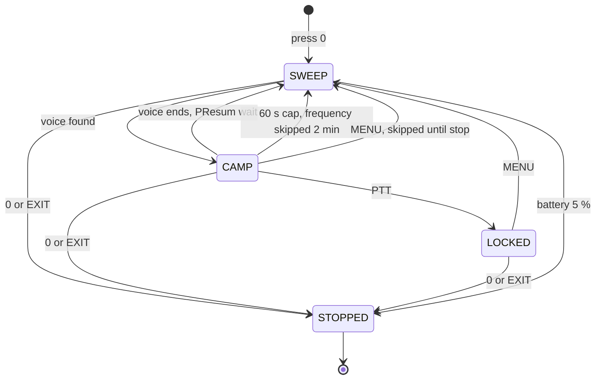

# VUURWERK Access Map (v1.5.1)

Every feature on one page: which key, which menu, which screen. The how and why live in [USER_MANUAL.md](USER_MANUAL.md); the feature tour is [FEATURES.md](FEATURES.md); the overview is [README.md](README.md).

Key names used here: STAR is the * key, F is the # key. "F+5" means press F, let go, then press 5.

## Contents

- [Shortcuts](#shortcuts)
- [Side keys](#side-keys)
- [Menu](#menu)
- [Screen](#screen)
- [Automatic](#automatic)
- [Spectrum](#spectrum)
- [PATROL](#patrol)
- [Hidden and power-on gestures](#hidden-and-power-on-gestures)

## Shortcuts

All of these work on the main screen. Inside the menu an F shortcut only double-beeps. A refusal is a double beep plus the toast in the last column.

| Key | Does | Toast | Refused with |
|---|---|---|---|
| F+0 | Cycles modulation FM, AM, USB | `MOD: FM` `MOD: AM` `MOD: USB` | |
| F+1 | Next frequency band | `BAND` | `FREQ ONLY` in memory mode |
| F+2 | Switches VFO A and B | `VFO: A` `VFO: B` | |
| F+3 | Switches VFO mode and memory mode | `VFO MODE` `MR MODE` | `NO CHANNELS` when nothing is stored |
| F+4 | Squelch level up one, 9 wraps to 0 | `SQL: n` | |
| F+5 | Opens the spectrum | none | lock prompt when the keypad is locked |
| F+6 | Cycles TX power LOW, MID, HIGH | `PWR: LOW` `PWR: MID` `PWR: HIGH` | |
| F+7 | Bandscope on the centre line on or off | `SCOPE ON` `SCOPE OFF` | |
| F+8 | Reverse: swaps RX and TX frequencies | `REVERSE` `NORMAL` | |
| F+9 | Jumps to the band's calling frequency | `CALL FREQ` | `FREQ ONLY` in memory mode, `NO BAND` outside the table |
| F+STAR | Starts a CTCSS/DCS tone scan on this frequency | | `FM ONLY` in AM or USB |
| F+EXIT | Resets the VFO to simplex: offset, tones, scrambler and reverse off, FM | `SIMPLEX` | `FREQ ONLY` in memory mode |
| hold F | Keypad lock on or off | `LOCKED` `UNLOCKED` | |
| hold STAR | Scan on or off | `SCAN ON` `SCAN OFF` | `EMPTY LIST` on a list with no channels |
| hold a digit | The F shortcut for that digit, without pressing F | as above | as above |
| hold MENU | The M Long action from the menu | depends on the action | |

> **F+1 band slots.** The bands run 1 to 7 and wrap after 7. The 350 MHz band is skipped while 350 En is OFF. The band number shows as `F1` to `F7` beside the frequency.

> **F+5 and the lock.** When the keypad is locked the spectrum refuses to open: the screen shows `Long press #` / `to unlock` for 2 seconds with a double beep. Hold F to unlock first.

> **F+9 is a one-way jump.** It sets the frequency, step and modulation for the band you are on, drops tones and offset, and leaves you in simplex. To go back, key the old frequency.

| Band you are on | Calling frequency | Mode |
|---|---|---|
| 144.000 to 144.300 MHz | 144.200 | USB |
| 144.000 to 148.000 MHz | 146.520 | FM |
| 432.000 to 433.000 MHz | 432.100 | USB |
| 420.000 to 450.000 MHz | 446.000 | FM |
| 151.000 to 154.000 MHz | 151.940 | FM |
| 462.000 to 467.000 MHz | 462.5625 | FM |
| 26.900 to 27.410 MHz | 27.185 | FM |
| 156.000 to 162.000 MHz | 156.800 | FM |
| 118.000 to 136.000 MHz | 121.500 | AM |

The narrow SSB segments are checked first, so 144.250 MHz jumps to 144.200 USB while 145.500 MHz jumps to 146.520 FM.

### Tone scan from the menu

1. **Open Menu > TONE > RxCTCS** (or RxDCS) and press MENU to edit it.
2. **Press STAR.** `SCAN` and a row of moving dots appear. FM only; a double beep means AM, USB or cross band.
3. **Wait for the beep.** The found tone lands in RxCTCS or RxDCS.
4. **Press MENU** to keep it, or EXIT to leave it unchanged.

The tone scan from the main screen (F+STAR) shows its own screen: `FREQ:`, `CTC:******` until found, then `SCAN CMP.` on a hit, `SCAN FAIL.` after 30 seconds with nothing found, or `NO SIGNAL` (with a toast and a double beep) when there is no carrier to read. The radio measures signal strength, not audio, before it starts.

## Side keys

Set SIDE1, SIDE2 and the held MENU key in Menu > CONFIG (F1Shrt, F1Long, F2Shrt, F2Long, M Long). Defaults: SIDE1 short MONITOR, SIDE1 long FLASH LIGHT, SIDE2 short SCAN, SIDE2 long NONE, M Long NONE.

| Action | What it does | Toast |
|---|---|---|
| NONE | Nothing | |
| FLASH LIGHT | LED off, on, blink, SOS, off. Turns itself off after 30 minutes, 10 minutes when the battery is low; SOS never | none |
| POWER | Cycles TX power LOW, MID, HIGH | `PWR: LOW` `PWR: MID` `PWR: HIGH` |
| MONITOR | Opens the squelch; again closes it | `MON ON` `MON OFF` |
| SCAN | Starts a scan; during a memory scan steps the list 1, 2, all; during a frequency scan stops it | `SCAN ON` `SCAN OFF` |
| LOCK KEYPAD | Keypad lock on or off (not in the menu, not while transmitting) | `LOCKED` `UNLOCKED` |
| SWITCH VFO | Switches VFO A and B | `VFO: A` `VFO: B` |
| VFO/MR | Switches VFO mode and memory mode | `MR MODE` `VFO MODE` |
| SWITCH DEMODUL | Cycles FM, AM, USB | `MOD: FM` `MOD: AM` `MOD: USB` |
| SPECTRUM | Opens the spectrum (lock prompt when locked) | none |

A short press acts when you let go. A long press acts once when the hold time is reached, and letting go then does nothing more.

### Locked keypad

| Situation | What happens |
|---|---|
| Still works | PTT, both side keys, a held MENU |
| Refused | Every other key: double beep and `Long press #` / `to unlock` for 2 seconds |
| Unlock | Hold F; the toast says `UNLOCKED` |
| Auto-lock | Menu > CONFIG > KeyLck AUTO locks 15 seconds after the last key; the countdown pauses in the menu and during scans |

## Menu

Press MENU on the main screen for the category picker. Digits 1 to 6 jump straight to a category, 7 as well once UNLOCK is showing. In a category UP and DOWN move, MENU edits or accepts, EXIT backs out, and a digit jumps to that item number. The menu closes by itself after 20 seconds without a key (2 minutes on BatVol and BatCal).

```
+----------------------------+
|                    [BATT#] |
| 1 RECEIVE                  |
|>2 TONE<                    |
| 3 TX                       |
| 4 SCAN                     |
| 5 CHANNEL                  |
| 6 CONFIG                   |
| 7 UNLOCK                   |
+----------------------------+
```

| Element | Meaning |
|---|---|
| `>2 TONE<` | The cursor row, drawn inverted on the radio |
| `7 UNLOCK` | Only present after the power-on unlock gesture |
| Bottom row in an item | A hint such as `PATROL ONLY`, or `SCAN 7/11` (item 7 of 11) |

### RECEIVE

| Item | What it controls | Values |
|---|---|---|
| Step | Tuning step | 0.01kHz to 500.00kHz |
| W/N | Channel bandwidth | WIDE, NARROW |
| Compnd | Compander | OFF, TX, RX, TX/RX |
| Demodu | Modulation | FM, AM, USB |
| AM Fix | AM overload correction | OFF, ON |
| RxMode | Dual watch and cross band | MAIN ONLY, DUAL RX RESPOND, CROSS BAND, MAIN TX DUAL RX |
| Sql | Squelch level | 0 to 9 |

### TONE

| Item | What it controls | Values |
|---|---|---|
| RxDCS | Receive DCS code | OFF, D023N to D754I |
| RxCTCS | Receive CTCSS tone | OFF, 67.0Hz to 254.1Hz |
| TxDCS | Transmit DCS code | OFF, D023N to D754I |
| TxCTCS | Transmit CTCSS tone | OFF, 67.0Hz to 254.1Hz |
| Scramb | Scrambler | OFF, 2600Hz to 3500Hz |
| STE | Squelch tail elimination | OFF, ON |
| RP STE | Repeater tail delay | OFF, 1*100ms to 10*100ms |

### TX

| Item | What it controls | Values |
|---|---|---|
| TxPwr | Transmit power | LOW, MID, HIGH |
| TxODir | Repeater offset direction | OFF, +, - |
| TxOffs | Repeater offset in MHz | typed, six digits |
| BusyCL | No transmit on a busy channel | OFF, ON |
| TxTOut | Transmit time-out | 30 sec, 1 min to 9 min, 15 min |
| Mic | Microphone gain | five steps in dB |
| Roger | End-of-transmission beep | OFF, ROGER, MDC |
| PTT ID | Tone sent with PTT | OFF, UP CODE, DOWN CODE, UP+DOWN CODE, APOLLO QUINDAR |
| D ST | Sidetone for the tone burst | OFF, ON |

Only APOLLO QUINDAR sends a tone in this firmware. UPCode, DWCode, D Prel and D Live are not in the menu; CHIRP can still edit them.

### SCAN

| Item | What it controls | Values |
|---|---|---|
| ScAdd1 | This channel in scan list 1 | OFF, ON |
| ScAdd2 | This channel in scan list 2 | OFF, ON |
| SList | Which list a memory scan uses | LIST1, LIST2, ALL |
| SList1 | Shows list 1 and its priority channels | read only |
| SList2 | Shows list 2 and its priority channels | read only |
| ScnRev | How a scan resumes | TIMEOUT, CARRIER, STOP |
| ScnWch | Watch the other VFO while scanning | OFF, SCAN A WATCH B, SCAN B WATCH A, SPLIT |
| PSens | PATROL sensitivity | LOW, NORM, HIGH |
| PSpeed | PATROL sweep speed | SLOW, NORM |
| PDwell | PATROL listen time after a hit | SHORT, NORM, LONG |
| PResum | PATROL wait before moving on | SHORT, NORM, LONG |

ScnWch is OFF at every power-on. SCAN A WATCH B and SCAN B WATCH A check the other VFO during a scan; a hop never disturbs what you tuned on VFO A. SPLIT arms `SP` in the status bar and alerts with `ACT 146.52000` style toasts when the other VFO hears activity. The four P items affect PATROL only; see [PATROL](#patrol).

### CHANNEL

| Item | What it controls | Values |
|---|---|---|
| ChSave | Saves the VFO to a channel | channel number, MENU twice (`SURE?`, `WAIT!`) |
| ChDele | Deletes a channel | used channels only, MENU twice |
| ChName | Names a channel | ten characters; UP/DOWN pick, STAR inserts -, F inserts a space |
| ChDisp | What a channel shows | FREQ, CHANNEL NUMBER, NAME, NAME+FREQ |
| 1 Call | One-call channel | channel number |

### CONFIG

| Item | What it controls | Values |
|---|---|---|
| F1Shrt | SIDE1 short press | NONE, FLASH LIGHT, POWER, MONITOR, SCAN, LOCK KEYPAD, SWITCH VFO, VFO/MR, SWITCH DEMODUL, SPECTRUM |
| F1Long | SIDE1 long press | same list |
| F2Shrt | SIDE2 short press | same list |
| F2Long | SIDE2 long press | same list |
| M Long | MENU held | same list |
| KeyLck | Automatic keypad lock | OFF, AUTO |
| BatSav | Battery save ratio | OFF, 1:1, 1:2, 1:3, 1:4 |
| POnMsg | Boot screen | FULL, MESSAGE, VOLTAGE, NONE |
| BatTxt | Battery text in the status bar | NONE, VOLTAGE, PERCENT |
| BackLt | Backlight time | OFF, 5 sec, 10 sec, 20 sec, 1 min, 2 min, 4 min, ON |
| BLMin | Backlight dim level | 0 to 9 |
| BLMax | Backlight bright level | 1 to 10 |
| BltTRX | Backlight on TX or RX | OFF, TX, RX, TX/RX |
| Beep | Key beep | OFF, ON |
| BatVol | Battery voltage and percent | read only |
| About | Opens the About screen | MENU |

### UNLOCK

Hidden until you power on with PTT and SIDE1 held together; the radio then opens the picker with `7 UNLOCK` showing. It stays visible until you power off.

| Item | What it controls | Values |
|---|---|---|
| F Lock | Transmit band limits | DEFAULT+ 137-174 400-470, FCC HAM 144-148 420-450, CE HAM 144-146 430-440, GB HAM 144-148 430-440, 137-174 400-430, 137-174 400-438, DISABLE ALL, UNLOCK ALL |
| Tx 200 | Transmit on 200 MHz | OFF, ON |
| Tx 350 | Transmit on 350 MHz | OFF, ON |
| Tx 500 | Transmit on 500 MHz | OFF, ON |
| 350 En | Show the 350 MHz band | OFF, ON |
| ScraEn | Allow the scrambler | OFF, ON |
| BatCal | Battery calibration | UP and DOWN only |
| BatTyp | Battery pack | 1600mAh, 2200mAh |
| Reset | Factory reset, then reboot | VFO, ALL; MENU twice |

UNLOCK ALL must be confirmed ten times; between attempts the item reads `READ MANUAL`.

## Screen

The LCD has a status bar and seven rows below it. These four mock-ups are the main screen in its four states. The status bar icons are described in the table after them.

Idle, VFO A main:

```
+----------------------------+
|                    [BATT#] |
|  146.52000              F2 |
|                            |
|       H                    |
|                            |
|  446.00000                 |
|                            |
| 12.5kHz W FM               |
+----------------------------+
```

Receiving on VFO A:

```
+----------------------------+
|  RX              Q [BATT#] |
|  RX 146.52000           F2 |
|                            |
|  CT   H                    |
|  -105 S4  [####......]     |
|  446.00000                 |
|                            |
| RX S4 -105dBm Q2           |
+----------------------------+
```

Transmitting on VFO A:

```
+----------------------------+
|  TX                [BATT#] |
|  TX 146.52000           F2 |
|                            |
| ||||| CT   H               |
|                            |
|  446.00000                 |
|                            |
| TX 0:12 PWR:H              |
+----------------------------+
```

Scanning:

```
+----------------------------+
|  S                 [BATT#] |
|  146.53750              F2 |
|                            |
|       H                    |
|                            |
|  446.00000                 |
|                            |
| SCANNING 12c/s             |
+----------------------------+
```

### Status bar

| Position | Shows | When |
|---|---|---|
| Far left | TX, RX or power-save icon | transmitting, squelch open, sleeping |
| Next | `S` frequency scan, `1` `2` `*` memory scan on list 1, 2 or all, `Cs` tone scan, `S+W` scan and watch | a scan runs |
| Next | Dual watch or cross band icon | RxMode is not MAIN ONLY |
| Next | `SP` | ScnWch SPLIT armed |
| Middle | Key-lock icon, or the F icon | keypad locked, F armed |
| Next | `Q` plus 0 to 3 bars | receiving (signal quality) |
| Right | Battery voltage or percent | BatTxt VOLTAGE or PERCENT |
| Far right | Battery icon, blinks when low | always |

### VFO lines

| Element | Shows |
|---|---|
| Marker at the left edge | The main VFO; a hollow marker on the other VFO while it is receiving |
| `TX` or `RX` bold before the frequency | The VFO transmitting or receiving |
| Big frequency | `146.52000`; while typing, `-` fills the digits still to come |
| Channel display | per ChDisp: frequency, `CH-001`, the name, or name over frequency |
| `F1` to `F7` or `M12` small at the left | Band number in VFO mode, channel number in memory mode |
| Small row under the frequency | `CT` `DCS` `DCR` tone type (or `AM` `USB`), `L` `M` `H` power, `+` `-` offset, `R` reverse, `N` narrow, `SCR` scrambler |
| Big word instead of the frequency | `BUSY`, `BAT LOW`, `TX DISABLE`, `TIMEOUT`, `VOLT HIGH` |
| Bars at the left while transmitting | 2, 4 or 6 bars for LOW, MID, HIGH |

### Centre line

In order of priority: the signal bar while receiving (`-105 S4` and a bar, with a `+` and dB over S9 on strong signals), the bandscope when F+7 has turned it on, otherwise blank. A toast draws a white-bordered box over this line for about 1 second.

### Bottom line

| State | Text |
|---|---|
| Transmitting | `TX 0:12 PWR:H`, time counting up, power L, M or H |
| Receiving | `RX S4 -105dBm Q2`, S unit, calibrated dBm, quality 0 to 3 |
| Scanning | `SCANNING 12c/s`, channels per second |
| Idle | `12.5kHz W FM`, step, W or N, modulation |

Two full-screen messages replace all of this: `LOW BATTERY` / `Press EXIT` (EXIT closes it) and `Long press #` / `to unlock` (shown for 2 seconds after a key on a locked keypad).

## Automatic

Nothing to switch on. These run by themselves and this is how you notice them.

| Feature | What you notice |
|---|---|
| Adaptive squelch | Opens on voice, stays shut on noise, at every Sql level from 1 to 9 |
| Signal quality | `Q0` to `Q3` on the RX line and the `Q` bars in the status bar while receiving |
| Calibrated signal readout | S unit and dBm on the RX line and the centre bar |
| TX compressor | Your voice level stays even whether you whisper or shout |
| Soft PA ramp | No click or thump at the start of a transmission |
| Battery sag readout | `SAG 0.25V` toast after a transmission when the pack sagged noticeably; the About screen shows the last value |
| Squelch tail | A clean close instead of a burst of noise when the other station unkeys |
| Dual watch | The two VFOs alternate quickly and pause while you hold a key |
| Battery save | The radio sleeps between checks after 10 seconds idle, per BatSav |
| Flashlight time-out | Off after 30 minutes, 10 minutes on a low battery; SOS never times out |
| Low battery | `LOW BATTERY` / `Press EXIT` once; the battery icon blinks |
| Boot check | `BK4819 FAULT` / `RX/TX disabled` or `EEPROM FAULT` / `calib lost` at power-on warns of a dead radio chip or blank calibration |
| Auto key lock | KeyLck AUTO locks the keypad 15 seconds after the last key |
| Backlight fade | The light fades out over about 2 seconds instead of cutting off |
| About screen | Closes by itself after about 10 seconds, or on a signal |

## Spectrum

Open it with F+5, or a side key or M Long set to SPECTRUM. It starts centred on the VFO frequency, 64 bins of 25 kHz, in NORM mode, with PATROL off. EXIT takes you back to your own VFO. Details: [USER_MANUAL.md](USER_MANUAL.md#7-spectrum-analyzer).

```
+----------------------------+
| -130/-50           [BATT#] |
| 64x  146.52000     NORM FM |
| 25.00k    #            25k |
|      #    #     #          |
|  #   #    #  #  #   #      |
| ######_####_##_###_###_#__ |
| |..|....|.^..|....|....|.. |
| 145.76000 >80.00k 147.36000|
+----------------------------+
```

| Element | Meaning |
|---|---|
| `-130/-50` | Scale floor and ceiling in dBm |
| `64x` and `25.00k` | Bin count and scan step |
| `146.52000` | The strongest frequency seen |
| `NORM FM` | Mode (NORM, PEAK, VOX, or PTRL while PATROL runs) and modulation |
| `25k` | Listen bandwidth |
| Dotted horizontal line | The trigger level; anything above it gets listened to |
| Tick rail | A mark per bin, taller at round frequencies, an arrow under the peak |
| Bottom row | Window start, the navigation step after an arrow glyph (shown as `>`), window end |

### Modes

Press STAR to cycle; the name shows as a banner.

| Mode | What you see | What it does |
|---|---|---|
| NORM | Bars | Listens to the strongest signal above the trigger |
| PEAK | Bars plus slowly sinking peak-hold dots | Same, and remembers peaks |
| VOX | Only voice-like bins get a bar (short bar possible voice, tall bar likely voice, dot none) with a tick on the top row | Hunts voice; home of PATROL |

### Sweep view keys

| Key | NORM and PEAK | VOX |
|---|---|---|
| 1 / 7 | Scan step up / down (0.01k to 100k, wraps) | same |
| 2 / 8 | Navigation step larger / smaller | `SET LO` / `SET HI`: the PATROL range |
| 3 / 9 | Scale ceiling up / down 1 dB | same |
| 4 | Bin count 64, 32, 16, 128 | same |
| 5 | Type a frequency (STAR is the point, MENU accepts, EXIT backspaces) | same |
| 6 | Listen bandwidth 25k, 12.5k, 6.25k | same |
| 0 | Modulation FM, AM, USB | PATROL start or stop |
| F | Lower the trigger line 1 dB | same |
| STAR | Next mode | same |
| UP / DOWN | Move the window | Seek the next voice bin above / below; move the window if none |
| SIDE1 / SIDE2 | Move the window up / down | same |
| PTT | Park on the peak (STILL view) | Lock on the voice you hear, banner `LOCKED` |
| MENU | Hide the peak bin for this window | same; while PATROL is camped, skip that frequency |
| EXIT | Leave the spectrum | same, stopping PATROL first |

A `LOCKED` voice is released by UP, DOWN, STAR, MENU or any key that restarts the sweep. If you leave with the lock still on, in VFO mode, reverse off and inside the VFO's band, the locked frequency and modulation are carried into that VFO.

### STILL view keys

PTT in NORM or PEAK parks on the peak: the frequency on top, a meter bar, then `S: 9` and `-62 dBm`.

| Key | Does |
|---|---|
| UP / DOWN | Tune 1 kHz in FM, 0.5 kHz in AM, 0.1 kHz in USB |
| STAR / F | Trigger up / down |
| 3 / 9 | Scale ceiling up / down |
| 5 | Type a frequency |
| 0 | Modulation |
| 6 | Listen bandwidth |
| SIDE1 | Monitor (open squelch) on or off |
| SIDE2 | Backlight on or off |
| PTT | Nothing |
| EXIT | Back to the sweep |

## PATROL

PATROL is VOX mode left to hunt on its own over a range you set, camping on each voice it finds and moving on when it ends. Full guide: [USER_MANUAL.md](USER_MANUAL.md#8-patrol) and the walkthrough in [README.md](README.md#patrol-hunt-while-you-do-something-else).

### Keys

| Key | In VOX mode does |
|---|---|
| 2 | Stores the left edge of the window as the range start, banner `SET LO` |
| 8 | Stores the right edge of the window as the range stop, banner `SET HI` |
| 0 | Starts PATROL (label becomes `PTRL`); again stops it |
| PTT | Locks on the voice you hear, banner `LOCKED`; windows stop advancing |
| MENU | While camped: skips that frequency until PATROL stops |
| EXIT | Stops PATROL and leaves the spectrum |

While PATROL runs only 0, MENU, PTT and EXIT do anything. With the backlight off, the first key only wakes the screen.

### Set a range and start

1. **Press STAR** until the banner says `VOX`.
2. **Tune the window to the bottom of the range** (UP, DOWN, SIDE1, SIDE2 or key 5) and **press 2.** The banner says `SET LO`.
3. **Tune the window to the top** and **press 8.** The banner says `SET HI`.
4. **Press 0.** The corner label changes to `PTRL` and the hunt starts from the range start.

The range, with the step and modulation in force when you set it, is remembered across power cycles and a factory reset. With no range stored PATROL walks the window on screen. To change a range, press 2 or 8 again.

This is the life of a PATROL run from the moment you press 0.



SWEEP walks the range one window at a time and wraps at the top. CAMP listens for the PDwell time, then rechecks and leaves after PResum non-voice checks. At 5 % battery PATROL stops and the spectrum exits so the `LOW BATTERY` screen can show.

### While locked

| While locked, press | Result |
|---|---|
| MENU | Skips this frequency until PATROL stops and resumes the hunt |
| 0 | Stops PATROL; the lock stays, UP or DOWN then releases it |
| EXIT | Leaves the spectrum; the locked frequency can carry into the VFO |
| PTT again | Nothing |

### Settings

All in Menu > SCAN with the hint `PATROL ONLY`; the hold-to-sweep VOX mode is unchanged by them.

| Item | Values | What changes |
|---|---|---|
| PSens | LOW, NORM, HIGH | LOW wants a cleaner voice before it stops; HIGH stops on weaker signals; NORM is plain VOX behaviour |
| PSpeed | SLOW, NORM | SLOW takes a steadier read of each bin; NORM is the native rate |
| PDwell | SHORT, NORM, LONG | Listen 0.5 s, 1 s or 2 s after a hit before the first recheck |
| PResum | SHORT, NORM, LONG | Move on about 0.3 s, 0.6 s or 1.2 s after the voice ends |

Backlight during PATROL follows BackLt: every key restarts it, ON never dims, OFF never lights. Stopping PATROL lights the screen. A camp never lasts more than 60 seconds; a PTT lock holds for as long as you like.

## Hidden and power-on gestures

| Gesture | Result |
|---|---|
| Power on with PTT and SIDE1 held | Reveals the UNLOCK category and opens the menu picker |
| Any key held at power-on | `RELEASE` / `ALL KEYS` with the key's name; boot continues once everything is released |
| Hold F on the main screen | Keypad lock on or off, `LOCKED` / `UNLOCKED` |
| Hold STAR on the main screen | Scan on or off |
| Hold a digit on the main screen | That digit's F shortcut |
| Hold MENU on the main screen | The M Long action |
| Menu > CONFIG > About, then MENU | About screen: version, feature list and the last TX sag; closes on EXIT, MENU, a signal or after about 10 seconds |
| EXIT on the main screen | Switches VFO A and B (with nothing typed) |

Boot screens per POnMsg: FULL and MESSAGE show `VUURWERK` / `v1.5.1` / `Precision RF`; VOLTAGE shows `VOLTAGE` and the pack voltage and percent; NONE is blank. Each lasts about a second or until a key. Something wrong with the radio shows `BK4819 FAULT` or `EEPROM FAULT` instead; see [USER_MANUAL.md](USER_MANUAL.md#14-troubleshooting).

VUURWERK v1.5.1
