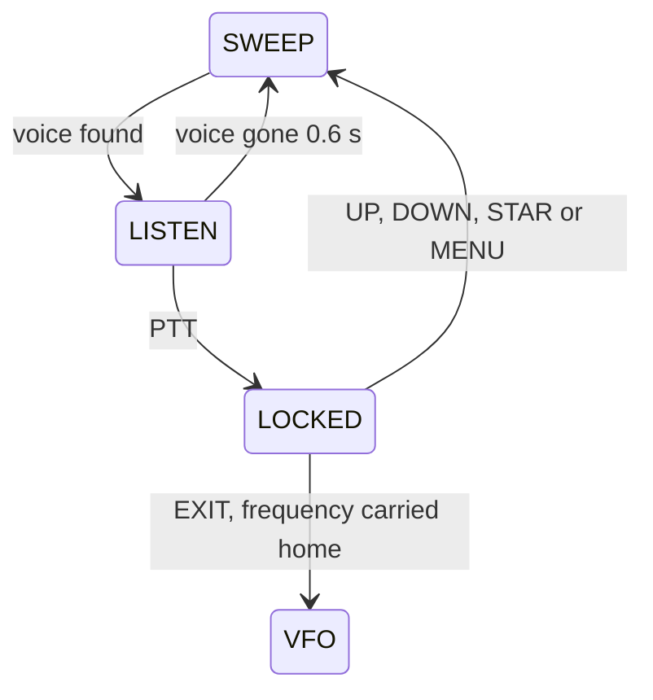
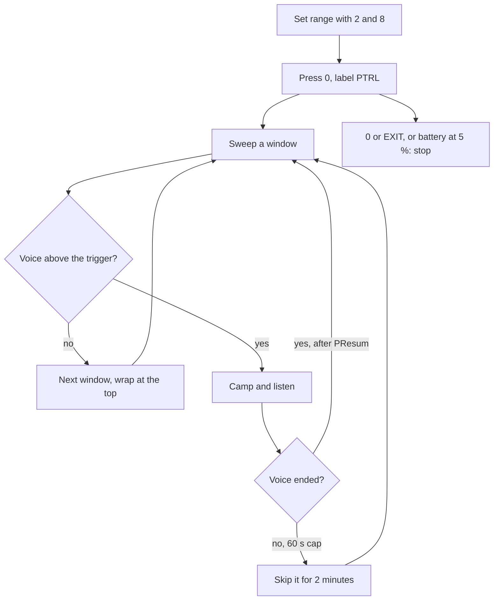

# VUURWERK Features

VUURWERK makes a Quansheng UV-K5 hear better, talk cleaner and hunt for voices on its own. This guide walks through every feature as you meet it on the radio: what it does for you, how you turn it on, and how you can tell it is working. For every key and menu item in one place see [USER_MANUAL.md](USER_MANUAL.md) and [ACCESS_MAP.md](ACCESS_MAP.md).

## Contents

- [Transmit](#transmit)
- [Receive](#receive)
- [Squelch](#squelch)
- [Scanning and Dual Watch](#scanning-and-dual-watch)
- [Spectrum and VOX](#spectrum-and-vox)
- [PATROL](#patrol)
- [Screen and Status Bar](#screen-and-status-bar)
- [Keys and Toasts](#keys-and-toasts)
- [Battery, Backlight and Safety](#battery-backlight-and-safety)
- [Inherited from egzumer](#inherited-from-egzumer)
- [Not in this build](#not-in-this-build)

## Transmit

Everything in this section is automatic. There is nothing to switch on and nothing to tune.

| Feature | What it does for you | How you reach it |
|---|---|---|
| Automatic mic level | Catches a shout at once and eases back smoothly when you drop your voice, so you sound even at the far end | Always on; Menu > TX > Mic still sets your base level |
| Soft key-up | TX power ramps up instead of snapping on, so the other station hears no click | Always on |
| Tone lead-in | On a channel with a CTCSS or DCS tone, the tone goes out a moment before your voice so the repeater opens cleanly | Always on when the channel carries a TX tone |
| Live battery while transmitting | The battery reading keeps updating while you hold PTT instead of freezing | Always on; watch the status bar |
| Sag warning | After a transmission that pulled the pack down by 0.20 V or more, a `SAG 0.25V` style toast tells you | Automatic; the About screen keeps the last reading |
| Quiet backlight | A dimmed backlight no longer puts a whine on your transmitted audio | Always on |

How you can tell it is working: the row 6 line reads `TX 0:07 PWR:H` while you talk, counting up from `0:00`. If the pack is getting tired you see the `SAG` toast when you let go of PTT, and Menu > CONFIG > About shows `TX sag 250mV` on its last row.

> **Sag is a health check.** A sag of 50 to 100 mV is a healthy pack. A sag of 400 mV or more means the cells are aging, and the radio will struggle on HIGH power.

## Receive

| Feature | What it does for you | How you can tell |
|---|---|---|
| Adaptive gain | FM receive gain follows the signal strength, so strong stations do not splatter and weak ones are not buried; it resets on every frequency change | Audio stays clean from weak to strong |
| True S-meter | The S number and the dBm figure are calibrated and agree with each other on the centre bar and on the row 6 line | `RX S7 -83dBm Q3` |
| AM distortion guard | Airband and other AM signals are kept from overloading the receiver | Menu > RECEIVE > AM Fix, ON |
| Signal quality | A Q figure from 0 to 3 tells you how clean the signal is, not just how strong | `Q` and bars in the status bar, `Qn` on the row 6 line |
| Noise floor learning | The radio learns the idle noise level while it sits on a quiet frequency | The dotted line on the bandscope |

What the Q figure means:

| Q | Meaning |
|---|---|
| Q0 | Rough: noise or a signal breaking up |
| Q1 | Usable but noisy |
| Q2 | Clean enough for easy copy |
| Q3 | Steady and clean |

## Squelch

Smart squelch is always on. It opens sooner on weak voice and stays shut on noise, and it is never tighter than the level you choose in Menu > RECEIVE > Sql (or F+4, toast `SQL: n`). Set Sql the way you always have; the radio only ever makes it more forgiving to voice.

| Item | Values | What it does |
|---|---|---|
| Sql | 0 to 9 | Your squelch level, the floor the smart squelch respects |
| STE | OFF, ON | Mutes the squelch tail on CTCSS and DCS channels, so the other station's release ends in silence rather than a burst of noise |
| RP STE | OFF, 1\*100ms to 10\*100ms | Repeater tail delay, for repeaters that drop the tone before the carrier |

Both STE items live in Menu > TONE.

## Scanning and Dual Watch

| Feature | What it does for you | How you reach it |
|---|---|---|
| Adaptive scan | Empty channels are left quickly, channels with energy get a longer look | Hold STAR, toast `SCAN ON` |
| Scan rate | The row 6 line shows how fast the scan is moving | `SCANNING 12c/s` after the first second |
| Scan resume | Choose what happens after a stop: resume after a timeout, when the carrier drops, or never | Menu > SCAN > ScnRev: TIMEOUT, CARRIER, STOP |
| Intelligent dual watch | Dual watch alternates quickly, leans toward the busier VFO and pauses while you hold a key | Menu > RECEIVE > RxMode, DUAL RX RESPOND |
| Scan+Watch | Scan one VFO while keeping an eye on the other; the watched VFO gets a quick look every few steps and holds for 2 s when it opens | Menu > SCAN > ScnWch: SCAN A WATCH B or SCAN B WATCH A |
| VFO Split | VFO B walks your memory list while you sit on VFO A; when a channel goes active you get an `ACT 146.52000` toast and a beep, once per activity | Menu > SCAN > ScnWch: SPLIT |

Status bar glyphs tell you which scan is running: `S` for a frequency scan, `1`, `2` or `*` for a memory scan on list 1, list 2 or all, `S+W` for Scan+Watch and `SP` while Split is armed. ScnWch is off every time you power on.

> **Scanning an empty list** shows the toast `EMPTY LIST` and stops. Add channels with Menu > SCAN > ScAdd1 or ScAdd2.

### Tone scan

Press F+STAR on the frequency you are listening to and the radio finds the CTCSS or DCS tone in use.

1. **Press F, then STAR.** The scanner screen opens with `FREQ:` on row 1 and `CTC:******` on row 3. The status bar shows `Cs`.
2. **Wait.** Row 5 shows `SCAN` with moving dots. A short high beep and `SCAN CMP.` mean the tone was found and is shown on row 3.
3. **Nothing found?** After 30 s the radio gives up with a low double beep and `SCAN FAIL.`. If there was no carrier to start with it says `NO SIGNAL` at once.

Tone scan works on FM only: in AM or USB the combo refuses with `FM ONLY`. You can also start one from inside the menu: while editing RxCTCS or RxDCS, press STAR and the found code lands on the item. Both beeps are silent with Menu > CONFIG > Beep set to OFF.

## Spectrum and VOX

Open the spectrum with F+5, or with a side key or M Long set to SPECTRUM. It opens centred on your VFO frequency, in NORM mode, 64 steps of 25 kHz. It will not open while the keypad is locked.

```
+----------------------------+
|-130/-50            [BATT#] |
|64x  146.52000     VOX   FM |
|25.00k    .  .  #  .  #  25k|
|          =     #     #     |
|.....=....=..#..#..=..#.....|
|                            |
||..|....|....|....|....|..^.|
|145.76000  >80.00k 148.96000|
+----------------------------+
```

| Row | What it shows |
|---|---|
| Status bar | Scale floor and ceiling in dBm, battery |
| Row 0 | Step count, peak frequency, mode label (`NORM`, `PEAK`, `VOX`, or `PTRL` while PATROL runs), modulation |
| Row 1 | Scan step on the left, listen bandwidth on the right |
| Rows 0 to 4 | The bars; in VOX mode a dot marks every bin and only voice bins get a bar |
| Row 5 | Tick rail with an arrow under the peak |
| Row 6 | Window start, navigation step (the `>` stands for the arrow glyph), window end |

### Modes

STAR cycles the mode and shows its name as a banner for a moment.

| Mode | What you see | What the radio does |
|---|---|---|
| NORM | Plain bars | Sweeps; stops and listens on the strongest bin above the trigger line, rechecks every second |
| PEAK | Bars plus peak-hold dots that slowly sink | Same as NORM, with a memory of what has been there |
| VOX | A dot per bin, a half bar for possible voice, a full bar for likely voice | Listens only to bins that sound like voice, holds through speech gaps, lets go about 0.6 s after the voice ends |

### Keys in the sweep

| Key | NORM and PEAK | VOX |
|---|---|---|
| 1 / 7 | Scan step up / down | Same |
| 2 / 8 | Navigation step larger / smaller | PATROL range: 2 = `SET LO`, 8 = `SET HI` |
| 3 / 9 | Scale ceiling up / down | Same |
| 4 | Step count 64x, 32x, 16x, 128x | Same |
| 5 | Type a frequency (STAR is the decimal point, MENU accepts) | Same |
| 6 | Listen bandwidth 25k, 12.5k, 6.25k | Same |
| 0 | Modulation FM, AM, USB | Start or stop PATROL |
| F | Lower the trigger line | Same |
| STAR | Next mode | Same |
| UP / DOWN | Move the window | Seek the next voice bin up / down; with none that way, move the window |
| SIDE1 / SIDE2 | Move the window up / down | Same |
| PTT | Park on the peak (the STILL meter) | Lock onto the voice you are hearing, banner `LOCKED` |
| MENU | Blacklist the peak for this window | Same |
| EXIT | Leave | Leave |

A manual seek with UP or DOWN plays a rising two-tone chord when it finds a voice (silent with Beep OFF). An automatic stop never plays it.

### Locking and carrying a frequency home

Press PTT while VOX is listening and the radio pins itself to that frequency with the banner `LOCKED`. It stays there until you press UP, DOWN, STAR or MENU, or change the step, span or window. Press EXIT while locked and, if your VFO is in frequency mode, reverse is off and the frequency lies inside that VFO's band, the locked frequency and the modulation you were hearing are written into the VFO. Your offset and tones are left alone and no memory channel is ever touched.

> **Match the step to the channel spacing** (keys 1 and 7) before you lock, so the carried frequency lands exactly on the channel.

This is the VOX life cycle in one picture.



## PATROL

PATROL is VOX mode left to work on its own. Set a range, press 0, put the radio down: it walks the range window by window, camps on anything that sounds like voice, and moves on when the talking stops. The fuller illustrated guide is in [README.md](README.md#patrol-hunt-while-you-do-something-else) and the reference is [USER_MANUAL.md](USER_MANUAL.md#8-patrol).

```
+----------------------------+
|-130/-50            [BATT#] |
|64x  146.52000     PTRL  FM |
|25.00k       .        #  25k|
|                      #     |
|.............=........#.....|
|                            |
||..|....|....|....|....|..^.|
|145.76000  >80.00k 148.96000|
+----------------------------+
```

The only visible difference from VOX is the label: `PTRL` in the top right corner.

### Starting a patrol

1. **Open the spectrum** with F+5 and press STAR until the banner says `VOX`.
2. **Move the window** (UP, DOWN, SIDE1, SIDE2, or key 5 to type a frequency) so its left edge sits where you want the range to begin. **Press 2.** The banner says `SET LO`.
3. **Move the window** so its right edge sits where the range should end. **Press 8.** The banner says `SET HI`.
4. **Press 0.** The label changes to `PTRL` and the hunt begins from the bottom of the range.
5. **Press 0 again, or EXIT, to stop.**

Each press of 2 or 8 also remembers the scan step and the modulation in force, and the range survives power cycles and a factory reset. With no range set, PATROL sweeps the window on screen. There is no clear key: a new press of 2 or 8 simply replaces the old edge.

### Keys while patrolling

| Key | What it does |
|---|---|
| 0 | Stop PATROL (the view stays open) |
| MENU | While camped: skip this frequency until PATROL stops |
| PTT | Lock onto the voice being heard, banner `LOCKED`; a lock is never cut off by the dwell cap |
| EXIT | Stop PATROL and leave the spectrum |
| Any other key | Ignored; restarts the backlight timer, and wakes the screen when it is dark |

### Settings

All four live in Menu > SCAN with the hint `PATROL ONLY`. They affect PATROL only; hand-held VOX is unchanged.

| Item | Values | What it does |
|---|---|---|
| PSens | LOW, NORM, HIGH | LOW wants a cleaner voice before it stops; NORM is plain VOX behaviour; HIGH stops on weaker signals |
| PSpeed | SLOW, NORM | SLOW settles longer on each step for weak signals; NORM is the normal sweep |
| PDwell | SHORT, NORM, LONG | Guaranteed listen after a hit: 0.5 s, 1 s, 2 s |
| PResum | SHORT, NORM, LONG | How long after the voice ends before moving on: about 0.3 s, 0.6 s, 1.2 s |

### What happens on a run

This is the flow from setting a range to stopping.



- A station that never stops talking is left after 60 s and skipped for 2 minutes of sweeping. A PTT lock is exempt and holds as long as you like.
- MENU while camped skips that frequency until PATROL stops.
- The BackLt timeout applies during PATROL, so the screen can go dark; the first key press only wakes it. Set BackLt to ON to keep it lit, or OFF to keep it dark and have every key act at once. Stopping PATROL lights the screen.
- When the battery reaches 5 % or less, PATROL stops, the spectrum closes and the usual `LOW BATTERY` screen appears.

## Screen and Status Bar

```
+----------------------------+
|S  [DW]        Q||| [BATT#] |
|  146.52000              F2 |
|                            |
|       H                    |
|  -83 S7 [#######...]       |
|  446.00000                 |
|                            |
| RX S7 -83dBm Q3            |
+----------------------------+
```

| Row | What it shows |
|---|---|
| Status bar | Scan glyph, dual watch or crossband icon, `SP`, key lock or F icon, `Q` bars while receiving, battery text and icon |
| Row 0 | VFO A: `TX` or `RX` on the active side, the frequency or channel name, scan list icons |
| Row 1 | `F2` style band label (or `M12` for a channel), compander icon |
| Row 2 | Tone type (`CT`, `DCS`, `DCR`), power `L` `M` `H`, offset `+` `-`, `R` reverse, `N` narrow, `SCR` |
| Row 3 | Signal bar while receiving, or the bandscope, or a toast |
| Rows 4 to 5 | VFO B, same layout |
| Row 6 | Context line |

Status bar glyphs:

| Glyph | Meaning |
|---|---|
| `S` | Frequency scan running |
| `1`, `2`, `*` | Memory scan on list 1, list 2 or all |
| `Cs` | Tone scan running |
| `S+W` | Scan+Watch active |
| `SP` | VFO Split armed |
| `Q` plus 0 to 3 bars | Signal quality while receiving |
| F icon | F is armed for a shortcut |
| Lock icon | Keypad locked |

The row 6 context line:

| State | Line |
|---|---|
| Idle | `12.5kHz W FM` (step, W or N, modulation) |
| Receiving | `RX S7 -83dBm Q3` |
| Transmitting | `TX 0:07 PWR:H` |
| Scanning | `SCANNING 12c/s` |

A toast is a small boxed message on row 3 that lasts about 1 second. The bandscope (F+7, toast `SCOPE ON`) draws a scrolling 128 column trace on row 3 with peak dots that slowly sink and, once the radio has learned the noise floor, a dotted line at that level.

## Keys and Toasts

The complete key map is in [ACCESS_MAP.md](ACCESS_MAP.md). STAR is the * key and F is the # key.

| Combo | Action | Toast | Refusal |
|---|---|---|---|
| F+0 | Modulation FM, AM, USB | `MOD: FM` `MOD: AM` `MOD: USB` | |
| F+1 | Next band | `BAND` | `FREQ ONLY` in memory mode |
| F+2 | Switch VFO | `VFO: A` `VFO: B` | |
| F+3 | VFO or memory mode | `VFO MODE` `MR MODE` | `NO CHANNELS` with none stored |
| F+4 | Squelch level up, 9 wraps to 0 | `SQL: n` | |
| F+5 | Open the spectrum | none | lock prompt when locked |
| F+6 | TX power LOW, MID, HIGH | `PWR: LOW` `PWR: MID` `PWR: HIGH` | |
| F+7 | Bandscope on or off | `SCOPE ON` `SCOPE OFF` | |
| F+8 | Reverse on or off | `REVERSE` `NORMAL` | |
| F+9 | Jump to the band's calling frequency | `CALL FREQ` | `FREQ ONLY`, `NO BAND` |
| F+STAR | Tone scan | | `FM ONLY` |
| F+EXIT | Reset the VFO to plain simplex | `SIMPLEX` | `FREQ ONLY` |

Held keys: hold F to lock or unlock the keypad (`LOCKED`, `UNLOCKED`); hold STAR to start or stop a scan (`SCAN ON`, `SCAN OFF`); hold a digit to run that F shortcut without pressing F first. A refusal always comes with a double beep.

Side keys (Menu > CONFIG > F1Shrt, F1Long, F2Shrt, F2Long, M Long):

| Action | Toast |
|---|---|
| NONE | |
| FLASH LIGHT | none; cycles off, on, blink, SOS |
| POWER | `PWR: LOW` `PWR: MID` `PWR: HIGH` |
| MONITOR | `MON ON` `MON OFF` |
| SCAN | `SCAN ON` `SCAN OFF` |
| LOCK KEYPAD | `LOCKED` `UNLOCKED` |
| SWITCH VFO | `VFO: A` `VFO: B` |
| VFO/MR | `MR MODE` `VFO MODE` |
| SWITCH DEMODUL | `MOD: FM` `MOD: AM` `MOD: USB` |
| SPECTRUM | none |

A long press fires once when the hold time is reached and gives a shorter, higher beep than a short press.

### The menu

A short press of MENU opens a category picker instead of a long flat list.

```
+----------------------------+
|                    [BATT#] |
|1 RECEIVE                   |
|>2 TONE<                    |
|3 TX                        |
|4 SCAN                      |
|5 CHANNEL                   |
|6 CONFIG                    |
|                            |
+----------------------------+
```

| Category | Items |
|---|---|
| RECEIVE | Step, W/N, Compnd, Demodu, AM Fix, RxMode, Sql |
| TONE | RxDCS, RxCTCS, TxDCS, TxCTCS, Scramb, STE, RP STE |
| TX | TxPwr, TxODir, TxOffs, BusyCL, TxTOut, Mic, Roger, PTT ID, D ST |
| SCAN | ScAdd1, ScAdd2, SList, SList1, SList2, ScnRev, ScnWch, PSens, PSpeed, PDwell, PResum |
| CHANNEL | ChSave, ChDele, ChName, ChDisp, 1 Call |
| CONFIG | F1Shrt, F1Long, F2Shrt, F2Long, M Long, KeyLck, BatSav, POnMsg, BatTxt, BackLt, BLMin, BLMax, BltTRX, Beep, BatVol, About |
| UNLOCK | F Lock, Tx 200, Tx 350, Tx 500, 350 En, ScraEn, BatCal, BatTyp, Reset |

Press a digit or MENU to open a category, UP and DOWN to move, EXIT to go back. The picker remembers where you were until you power off. UNLOCK appears only when you power on with PTT and SIDE1 held. Items with a hint show it on the bottom row; the four PATROL items share the hint `PATROL ONLY`. The menu closes by itself after 20 s without a key (2 minutes on BatVol and BatCal).

## Battery, Backlight and Safety

| Feature | What it does for you | Where |
|---|---|---|
| Flashlight auto-off | ON and BLINK switch off after 30 minutes, 10 minutes when the battery shows two bars or fewer; SOS never times out; a tap restarts the timer | A side key set to FLASH LIGHT |
| Backlight fade | The light tapers over about 2 s before it goes out instead of snapping off | Menu > CONFIG > BackLt |
| Lit while busy | The screen stays on while you talk or listen, including monitor | Menu > CONFIG > BltTRX: TX, RX, TX/RX |
| Battery save | The receiver naps between checks while idle, at the ratio you choose | Menu > CONFIG > BatSav |
| Battery text | Voltage or percent next to the icon | Menu > CONFIG > BatTxt: VOLTAGE, PERCENT |
| Auto key lock | The keypad locks itself 15 s after your last key | Menu > CONFIG > KeyLck: AUTO |
| About | Version, feature list and the last `TX sag` reading | Menu > CONFIG > About, closes after about 10 s |

### Boot checks

Every power-on checks the radio chip and the calibration store before the welcome screen. A healthy radio shows `VUURWERK`, `v1.5.1` and `Precision RF` for about a second (or the VOLTAGE screen, per POnMsg).

| Banner | Meaning | What to do |
|---|---|---|
| `BK4819` / `FAULT` / `RX/TX disabled` | The radio chip did not answer | Power off, reseat the battery, try again; if it stays, the hardware needs attention |
| `EEPROM` / `FAULT` / `calib lost` | The calibration store could not be read | Restore a saved calibration image, see [chirp/README.md](chirp/README.md) |
| `RELEASE` / `ALL KEYS` | A key was held at power-on | Let go; the radio continues on its own |

If the firmware ever crashes, the radio reboots at once rather than holding a carrier on the air with PTT keyed.

## Inherited from egzumer

VUURWERK keeps the egzumer features you already know, with the VUURWERK look on top:

- AM Fix for airband and the wide receive range
- Wide and narrow bandwidth, FM, AM and USB on every frequency
- Two scan lists with priority channels, plus scan all
- Channel names, channel display modes and the compander
- Scrambler, STE and RP STE, Roger beep and MDC
- F Lock bands and the TX enable switches in UNLOCK
- Battery calibration and type
- CHIRP compatibility with the driver in [chirp/README.md](chirp/README.md)
- The spectrum analyzer that VOX and PATROL grow from (fagci's work)

The people behind all of it are listed in [CREDITS.md](CREDITS.md).

## Not in this build

These stock features are left out to make room for the ones above:

- NOAA weather channels
- FM broadcast radio
- Voice prompts
- DTMF calling and the DTMF contact list
- Alarm
- A stand-alone 1750 Hz key
- Power-on password

Everything else you reach through the menu is live.

VUURWERK v1.5.1, James Honiball, KC3TFZ. 73 de KC3TFZ.
