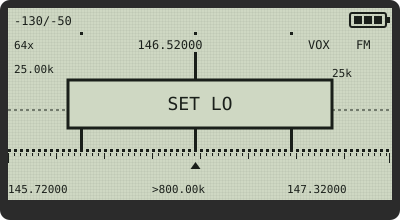
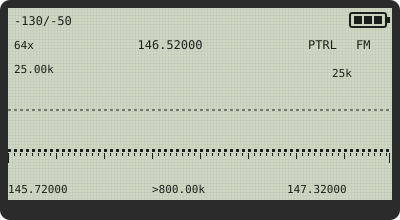
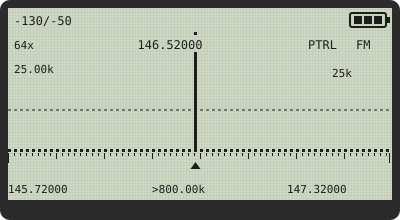
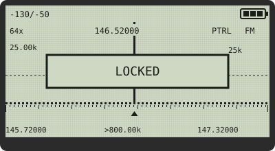
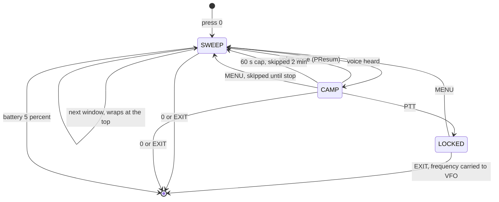
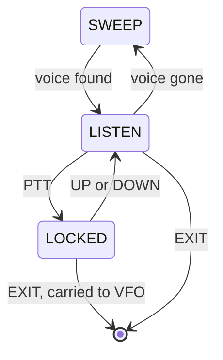

# VUURWERK

**Custom firmware that turns a $30 Quansheng UV-K5 into a radio that listens,
adapts, and responds like equipment ten times its price.**

VUURWERK is Afrikaans for *fireworks*.

[](https://github.com/Tokeloshe/vuurwerk-firmware/releases/latest)
[&color=success)](https://github.com/Tokeloshe/vuurwerk-firmware/releases/latest)
[](https://buymeacoffee.com/Tokeloshe)

---

## See It In Action

Power on a VUURWERK radio and, after the boot banner, this is your home screen:

```
+----------------------------+
|                   [BATT##] |
|  146.52000                 |
| F2                         |
|      CT H                  |
| .:|.||:..|,.:|||,.:.|..:|| |
|  446.00000                 |
| M12                        |
| 12.5kHz W FM               |
+----------------------------+
```

| Row | What you see |
|---|---|
| Status bar | F icon when F is armed, Q bars while receiving, battery (live even during TX) |
| VFO A | frequency in the big font; band label `F2` or channel `M12` under it |
| Indicators | tone type `CT`, `DCS` or `DCR`, power `L` `M` `H`, offset `+` `-`, `R` reverse, `N` narrow |
| Centre line | the bandscope (F+7) or, while receiving, the signal bar |
| VFO B | same layout as VFO A |
| Context line | step, bandwidth and modulation; changes with what the radio is doing |

When a signal comes in, the context line becomes the RX line:

```
| RX S7 -83dBm Q3            |
```

That trailing `Q3` is the signal-quality meter: it watches how steady the
signal is, from `Q3` (rock solid) down to `Q0` (heavy fading), so you can
tell a clean path from a fluttering one at a glance.

And this is the headline instrument, the Voice-Seeking Spectrum (F+5, then
STAR twice until the banner reads `VOX`):

```
+----------------------------+
| -130/-50          [BATT##] |
| 64x  146.52000    VOX   FM |
| 25.00k              #  25k |
|      +------------+ #      |
|  _.._|   LOCKED   |_#__.__ |
|      +------------+ #      |
| |..|....|....|....|.^.|..| |
|145.72000 >800.00k 147.32000|
+----------------------------+
```

| Row | What you see |
|---|---|
| Status bar | the dB scale floor and ceiling, battery |
| Row 0 | bin count `64x`, the peak frequency, mode label (`VOX`, or `PTRL` while PATROL runs), modulation |
| Row 1 | scan step on the left, listen bandwidth on the right |
| Rows 0-4 | the bars: a baseline dot for noise and carriers, a half bar for probable voice, a full bar for strong voice, each voice bin with a dot on the very top row |
| Rows 2-3 | the banner (`LOCKED`, `SET LO`, `SET HI` or the mode name) for a moment after you press a key |
| Row 5 | the tick rail with an arrow under the peak |
| Row 6 | span start, navigation step (the `>` stands in for the arrow glyph the radio draws) and span end |

Only bins that score as *human voice* draw bars. UP/DOWN hops between them.
PTT locks on. EXIT carries the frequency home to your VFO. No other UV-K5
firmware does this.

---

## PATROL: Hunt While You Do Something Else

PATROL turns the spectrum's voice hunt loose on a band you choose and lets the
radio do the listening. Set a range once, press one key, and it walks the
band, stops when it hears a voice, listens, and moves on when the
conversation ends.

New in v1.5.1. Only 0, MENU, PTT and EXIT act while it runs, so a pocketed
radio stays on task. It is a game changer.

<p align="center"> </p>

*1. In VOX, press 2 at the start of your range (`SET LO`), scroll up, press 8
at the end (`SET HI`).* *2. Press 0. The corner reads `PTRL` and the sweep
walks the range on its own.*

<p align="center"> </p>

*3. A voice: PATROL stops there and listens. When they finish, it moves on.*
*4. Like what you hear? PTT locks it. Press EXIT and that frequency comes
home to your VFO.*

Prefer text? The manual has the same screens drawn in ASCII:
[USER_MANUAL.md](USER_MANUAL.md#8-patrol).

### Your first patrol in 60 seconds

1. **F+5** opens the spectrum on your VFO.
2. **STAR, STAR** cycles NORM, PEAK, VOX; the banner says `VOX`.
3. **SIDE1/SIDE2** scroll to the bottom of the stretch you want to watch
   (UP/DOWN also scroll, but only when no voice lies that way), then **2**
   (toast `SET LO`).
4. Scroll to the top, then **8** (toast `SET HI`).
5. **0**: the corner reads `PTRL`. Put the radio down.
6. Later: **0** stops it, **EXIT** leaves the spectrum.

Next time it is F+5, STAR, STAR, 0: the range is remembered, even through a
power cycle or a Reset.

### What it does while you are not looking

The cycle PATROL runs, from sweep to listen and back.



- A camp is cut off after 60 seconds and that frequency is skipped for the
  next 2 minutes of sweeping, so one busy repeater cannot hog the run.
- A PTT lock is never capped: it holds until you release it.
- At 5 % battery PATROL stops and the radio returns to the main screen with
  `LOW BATTERY`.

### Keys while PATROL runs

| Key | Does |
|---|---|
| 0 | stop PATROL (the view stays open) |
| MENU | while camped: skip this frequency until PATROL stops |
| PTT | while camped: lock on it (`LOCKED`) |
| EXIT | stop and leave the spectrum (a locked frequency is carried to your VFO) |
| anything else | ignored (on a dark screen the first key only wakes the backlight) |

### The four settings

| Menu > SCAN | Values | Default | What it changes |
|---|---|---|---|
| PSens | LOW / NORM / HIGH | NORM | LOW wants a cleaner voice before it stops, HIGH stops on weaker signals |
| PSpeed | SLOW / NORM | NORM | SLOW settles longer on each step for a steadier read |
| PDwell | SHORT / NORM / LONG | NORM | how long it listens after a hit before checking again (0.5 / 1 / 2 s) |
| PResum | SHORT / NORM / LONG | NORM | how long after the voice ends before it moves on (about 0.3 / 0.6 / 1.2 s) |

All four on NORM give exactly the hand-held VOX hunt. The hint line reads
`PATROL ONLY`: they never touch the hold-to-sweep mode.

### Good to know

- Keep the scan step on your channel spacing (1/7) before you set the range,
  so camps land on real channels.
- With no range stored, PATROL walks the window on screen.
- The BackLt timer applies during PATROL (set it to ON if you want the screen
  lit).

Full chapter with worked examples: [USER_MANUAL.md](USER_MANUAL.md#8-patrol).
Every key: [ACCESS_MAP.md](ACCESS_MAP.md#patrol).

---

## Find Voices, Not Just Signals

The **VOX Voice-Seeking Spectrum** scores every frequency bin for voice
probability instead of raw strength, so carriers and birdies stay flat while
conversations light up. The hunt loop you drive by hand:



- **Seek**: UP walks to the next voice above the cursor, DOWN below. No voice
  that way? The keys fall through to normal span navigation, so they always
  move you.
- **Lock**: tap PTT while listening. A `LOCKED` banner shows and the radio
  parks there through any pause in the conversation, squelch open.
- **Carry-over**: exit while locked (in frequency mode, on the VFO's own band)
  and the locked frequency becomes your VFO frequency, in the modulation you
  were hearing, rounded to your VFO step. The VFO keeps its own offset and
  tones: if `+`, `-`, `CT` or `DCS` show after a simplex find, press F+EXIT
  before you answer.

Full detail: [USER_MANUAL.md](USER_MANUAL.md#vox-mode) and the
[spectrum chapter](USER_MANUAL.md#7-spectrum-analyzer).

---

## What Changes When You Flash This

| Feature | Key or menu | What you notice |
|---|---|---|
| Voice-seeking spectrum | F+5, STAR | only voices draw bars; UP/DOWN hop between them |
| PATROL | VOX, 2, 8, 0 | the radio hunts a range by itself |
| Bandscope | F+7 | a live activity strip on the home screen |
| Signal quality | automatic | `Q0` to `Q3` on the RX line and in the status bar |
| Smart squelch | automatic | opens for voices, stays shut for pagers and glitches |
| FM gain staging | automatic | strong signals clean, weak ones not buried |
| Squelch tail elimination | STE, RP STE | no "KSSHHH" at the end of a CTCSS or DCS transmission |
| TX compressor | automatic | shouts and close talking stay level |
| CTCSS lead-in | automatic | the repeater decodes your tone before your first word |
| TX soft start | automatic | no key-up click |
| Reset to simplex | F+EXIT | a deaf VFO is clean again, toast `SIMPLEX` |
| F-key shortcuts | F+0 to F+9 | one press for the things you change often |
| Categorised menu | MENU | six groups, number keys jump straight in, a hint line explains items |
| Calling frequency | F+9 | jump to the band's calling frequency |
| Tone scan | F+STAR, or STAR inside RxCTCS | finds a repeater's CTCSS or DCS code; the menu scan leaves your offset and TX tone untouched, so you can key up the moment it lands |
| Live battery during TX | automatic | the icon keeps updating while you talk; `SAG` warns of a tired pack |
| Flashlight watchdog | side key | the LED cannot drain a pocketed radio overnight |
| Backlight fade | automatic | fades out instead of cutting to black |
| CHIRP | computer | read and write channels and settings |

### You'll sound better to everyone listening

The **TX Compressor** rides your mic gain in real time: transparent at normal
speaking level, smoothly catching shouts and close talking. **CTCSS Lead-In**
mutes the mic for a moment at the start of every transmission so the
repeater decodes your tone before your first syllable. **TX Soft Start**
ramps the power up gently, killing the key-up click other radios hear.

### One gesture out of trouble

**F+EXIT resets the VFO to simplex.** A VFO that lights the green RX light but
stays silent almost always has a leftover setting: an RX tone waiting for a
match, a repeater offset, reverse, a scrambler. F+EXIT wipes the active VFO
back to clean simplex (tones off, offset off, reverse off, scrambler off, FM)
and shows `SIMPLEX`. Memory channels are never touched; there it answers
`FREQ ONLY`.

### You'll hear stations you couldn't before

The **smart squelch** weighs strength, audio cleanliness and interference
together, so it opens for voices and stays shut for pagers, glitches and
noise. **FM Gain Staging** adapts the receiver to signal strength as you
listen. **Squelch Tail Elimination** mutes the burst at the end of the other
station's transmission, for both CTCSS and DCS, on any repeater.

The **adaptive scan** skips empty channels almost instantly and only lingers
where there is signal, so an empty band scans faster with sensitivity
unchanged. Tone-coded memory channels get the time the decoder needs to
confirm the tone.

### Less time in menus

One press for everything you change often, each confirmed by a toast that
lasts about a second. STAR is the * key and F is the # key.

| Keys | What it does | Toast you see |
|---|---|---|
| F+0 | modulation FM, AM, USB | `MOD: FM` / `MOD: AM` / `MOD: USB` |
| F+1 | next band | `BAND` (`FREQ ONLY` in memory mode) |
| F+2 | switch VFO | `VFO: A` / `VFO: B` |
| F+3 | frequency or memory mode | `VFO MODE` / `MR MODE` (`NO CHANNELS` if none stored) |
| F+4 | squelch level, wraps 9 to 0 | `SQL: n` |
| F+5 | open the spectrum | none |
| F+6 | TX power | `PWR: LOW` / `PWR: MID` / `PWR: HIGH` |
| F+7 | bandscope on the home screen | `SCOPE ON` / `SCOPE OFF` |
| F+8 | repeater reverse | `REVERSE` / `NORMAL` |
| F+9 | the band's calling frequency, simplex, no tones | `CALL FREQ` (`NO BAND`, `FREQ ONLY`) |
| F+STAR | CTCSS/DCS tone scan | `FM ONLY` in AM or USB |
| F+EXIT | reset to simplex | `SIMPLEX` (`FREQ ONLY` in memory mode) |

The menu is sorted into six categories (RECEIVE, TONE, TX, SCAN, CHANNEL,
CONFIG); press the number to jump straight in, and a plain-language hint line
explains the cryptic items while you browse.

### It looks after itself

| Feature | What you notice |
|---|---|
| Power-on check | the radio confirms the transceiver answers and the battery calibration is present, and shows `BK4819 FAULT` or `EEPROM FAULT` in plain text if not |
| Crash restart | if the processor ever faults, the radio restarts instead of freezing, so a crash can never hold the transmitter on |
| Live battery | the battery indicator stays live during TX, and a sag tracker warns you when your pack is tiring |
| Flashlight watchdog | the flashlight switches itself off after 30 minutes, or 10 minutes when the battery shows two bars or fewer, so a pocket press never drains your pack overnight |
| Backlight fade | the backlight fades out instead of cutting to black, and with BltTRX set it stays lit while you are talking or listening |

### Program it from your computer

**CHIRP support** via a community-contributed driver: read and write channels,
side keys and settings without flashing back to stock. See
[chirp/README.md](chirp/README.md) for the one-time setup. Driver contributed
by mjwgeek.

---

## What Makes This Different

Stock firmware is open-loop: you set fixed values and hope they work. VUURWERK
is closed-loop: the radio measures what is actually happening, the noise
floor, signal strength, audio level, voice likelihood, and adjusts itself in
real time. It's the difference between holding the wheel straight with your
eyes closed and actually watching the road.

**Original innovations.** Intelligence-based squelch with voice-probability
scoring, voice-seeking spectrum analysis with PTT lock, frequency carry-over
and unattended PATROL, FM adaptive gain staging, universal squelch-tail
elimination, real-time TX audio compression. These aren't ports of existing
features. See [LICENSE](LICENSE) for the original-contributions registry and
[FEATURES.md](FEATURES.md) for the full feature guide.

---

## Flash It In 60 Seconds

```
 [download] --> [radio off] --> [hold PTT + power on] --> [LED lit?]
                                                              |
 [power cycle] <-- [flash ~10s] <-- [pick .packed.bin] <-- [cable in,
      |                              in Chrome flasher      Chrome open]
   VUURWERK
   boot screen
```

1. Download [`vuurwerk-v1.5.1.packed.bin`](https://github.com/Tokeloshe/vuurwerk-firmware/releases/latest/download/vuurwerk-v1.5.1.packed.bin)
   from the `release/` folder
2. Turn the radio off
3. Hold PTT and turn it on; the flashlight LED confirms bootloader mode
4. Connect your programming cable (standard Kenwood-style 2-pin)
5. Open https://egzumer.github.io/uvtools/ in Chrome
6. "Select firmware file" -> choose the `.packed.bin` -> "Flash firmware"
7. Wait about 10 seconds, disconnect, power cycle

Chrome is required (the Web Serial API doesn't work in Firefox or Safari).
Your channels and settings are preserved; only the firmware changes. Full
details and troubleshooting: [FLASHING.md](FLASHING.md).

---

## Hardware Compatibility

**VUURWERK only supports the original Quansheng UV-K5 V1 (DP32G030
processor).** The newer V2 (PY32F030) and V3 (PY32F071) boards are **not
compatible**; flashing them produces a radio that does not boot (recoverable
with the right stock firmware, but avoid the trip).

**How to check:** remove the battery and read the board label. V2 and V3
boards are marked; no marking means V1, the one VUURWERK supports.

**If you flashed the wrong hardware**, recover with
[K5TOOL](https://github.com/qrp73/K5TOOL), which supports all UV-K5 versions.

---

## Built By

**Firmware design and architecture:** James Honiball (KC3TFZ)
**Based on:** [Egzumer](https://github.com/egzumer/uv-k5-firmware-custom),
with credits to [DualTachyon](https://github.com/DualTachyon),
[OneOfEleven](https://github.com/OneOfEleven), [fagci](https://github.com/fagci)

See [CREDITS.md](CREDITS.md) and [LICENSE](LICENSE) for full attribution and
the complete list of VUURWERK-original contributions.

---

## Support VUURWERK

VUURWERK is free and built nights and weekends by one operator on a $30
radio. If PATROL found you a conversation, or F+EXIT rescued a deaf VFO,
you can keep the bench powered and keep going on this:

<p align="center">
  <a href="https://buymeacoffee.com/Tokeloshe">
    
  </a>
</p>

<p align="center">
  <a href="https://buymeacoffee.com/Tokeloshe">
    
  </a>
  <br>
  <em>Reading this on a desktop? Scan with your phone.</em>
</p>

Prefer crypto, or want to help without spending a cent? See
[DONATE.md](DONATE.md) for XRP and the free ways to support the project.

---

## Documentation

- [USER_MANUAL.md](USER_MANUAL.md): button-by-button operator manual with
  screen mock-ups for every feature
- [WHATS_NEW.md](WHATS_NEW.md): what's new in v1.5.1
- [CHANGELOG.md](CHANGELOG.md): version history and release checksums
- [FEATURES.md](FEATURES.md): the full feature guide
- [ACCESS_MAP.md](ACCESS_MAP.md): every feature and the key, menu or screen that reaches it
- [WHAT_VUURWERK_DOES.md](WHAT_VUURWERK_DOES.md): plain-English guide to every feature
- [BUILD.md](BUILD.md): building from source
- [FLASHING.md](FLASHING.md): flashing guide with troubleshooting
- [chirp/README.md](chirp/README.md): CHIRP driver (community-contributed by mjwgeek)
- [CREDITS.md](CREDITS.md): acknowledgments
- [DEDICATION.md](DEDICATION.md): in memory of ZS6NE
- [DONATE.md](DONATE.md): support the project
- [LICENSE](LICENSE): licence and the original-contributions registry

---

## License

VUURWERK is dual-licensed.

**Before you borrow code:** the VUURWERK-original features listed in
[LICENSE](LICENSE) are licensed as a package with the complete firmware.
Taking an individual feature, algorithm, or module into another project or
product requires written permission (a commercial license) from the author.
Read the notice at the top of [LICENSE](LICENSE) first.

**The complete VUURWERK firmware** is distributed under the GNU General Public
License v3. The upstream Egzumer / DualTachyon code it builds on is licensed
under the Apache License 2.0, which is compatible with GPL v3; upstream files
keep their Apache-2.0 notices. You may flash it, fork it, modify it, and
redistribute the complete firmware under GPL v3 terms.

**VUURWERK-original algorithms and modules** (listed in the
[LICENSE](LICENSE) contributions registry) are additionally protected by a
commercial-license requirement for any use outside the complete VUURWERK
firmware. Extracting a VUURWERK-original file, porting a VUURWERK-original
algorithm to another platform, or incorporating VUURWERK-original code into a
separate project requires a commercial license obtained in writing from James
Honiball (KC3TFZ).

Commercial licensing inquiries: jhoniball4@gmail.com

Stock upstream code (Egzumer, DualTachyon, OneOfEleven, fagci) remains under
its original license terms as marked in each file.

---

*VUURWERK (Afrikaans: fireworks), because your radio should light up.
Dedicated to George Thomas Honiball, ZS6NE: [DEDICATION.md](DEDICATION.md).*
