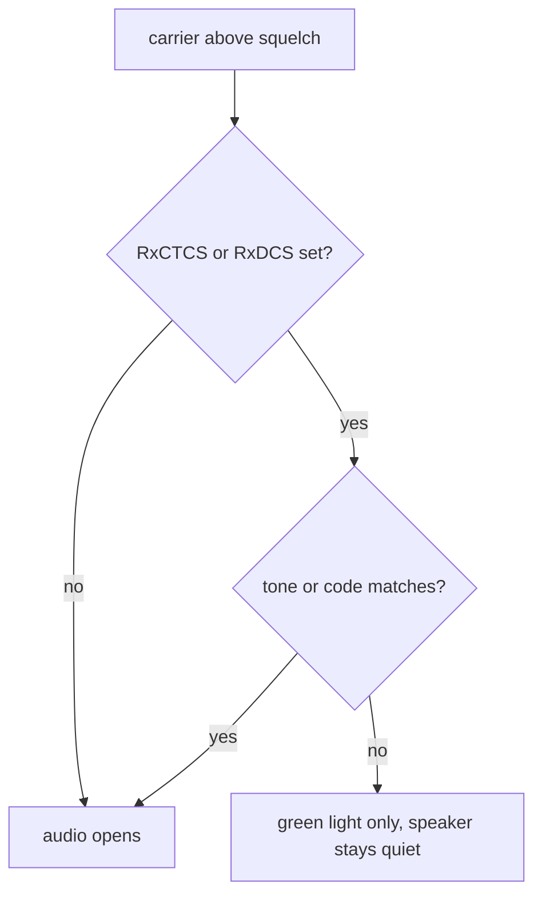
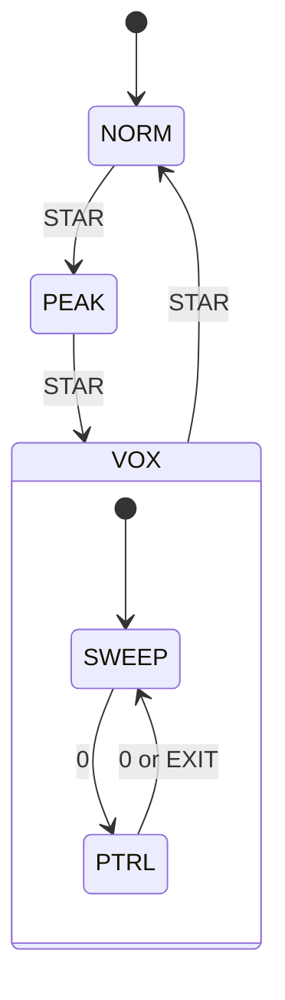
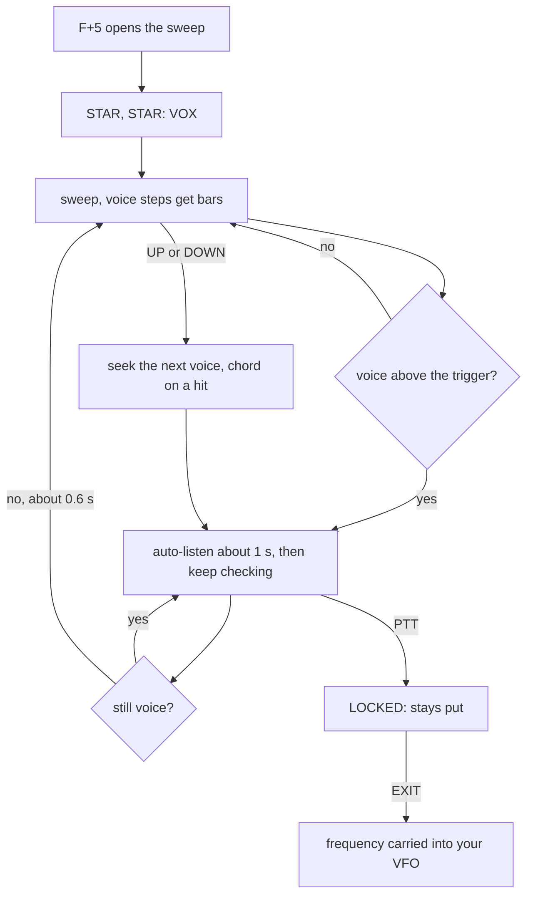
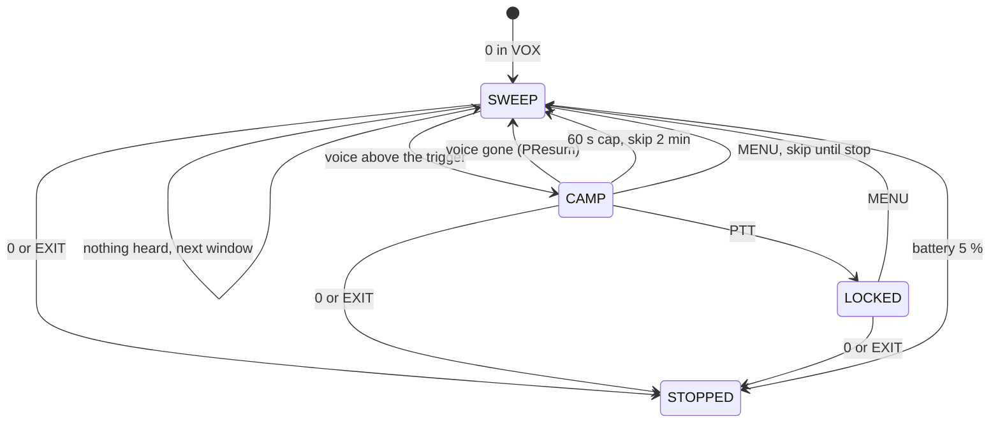

# VUURWERK User Manual

**Firmware:** v1.5.1 **Radio:** Quansheng UV-K5 (V1)

This is the full operator reference for VUURWERK. It describes what the radio does, key by key and screen by screen, exactly as you see it on the display.

Companion documents: [FEATURES.md](FEATURES.md) (the feature guide), [ACCESS_MAP.md](ACCESS_MAP.md) (every feature and how to reach it in one table), [WHATS_NEW.md](WHATS_NEW.md) (the tour of this release), [CHANGELOG.md](CHANGELOG.md) (the full version history), [FLASHING.md](FLASHING.md) (how to load the firmware) and [chirp/README.md](chirp/README.md) (programming with CHIRP).

## Table of Contents

1. [Getting Started](#1-getting-started)
2. [The Main Display](#2-the-main-display)
3. [Frequency and Mode](#3-frequency-and-mode)
4. [Receiving](#4-receiving)
5. [Transmitting](#5-transmitting)
6. [CTCSS and DCS](#6-ctcss-and-dcs)
7. [Spectrum Analyzer](#7-spectrum-analyzer)
8. [PATROL](#8-patrol)
9. [Bandscope](#9-bandscope)
10. [Special Functions](#10-special-functions)
11. [Channel Programming](#11-channel-programming)
12. [About Screen](#12-about-screen)
13. [Customization](#13-customization)
14. [Troubleshooting](#14-troubleshooting)
15. [What Happens Automatically](#15-what-happens-automatically)
16. [Cheat Sheet](#16-cheat-sheet)

### The keys

| Key | Where | Notes |
|---|---|---|
| PTT | left side, top | transmit |
| SIDE1, SIDE2 | left side, below PTT | assignable (see [13 Customization](#13-customization)) |
| MENU | keypad, top left | menu, accept |
| EXIT | keypad, top right | back, cancel, switch VFO |
| UP, DOWN | keypad | step, move |
| 0-9 | keypad | digits and F shortcuts |
| STAR | the * key | scan (long press) |
| F | the # key | shortcut prefix, keypad lock (long press) |

A combo such as F+5 means press F, release it, then press 5. A toast is the small boxed message that appears on the centre line of the main screen for about a second.

---

## 1 Getting Started

### Power-on

Turn the radio on and the welcome banner shows for about a second (or until you press a key). What you see depends on Menu > CONFIG > POnMsg.

| POnMsg | What shows |
|---|---|
| FULL | the VUURWERK banner |
| MESSAGE | the VUURWERK banner |
| VOLTAGE | the battery voltage and percentage |
| NONE | nothing, straight to the main screen |

The VUURWERK banner (FULL and MESSAGE):

```
+----------------------------+
|                            |
|VUURWERK                    |
|                            |
|                            |
|v1.5.1                      |
|                            |
|Precision RF                |
|                            |
+----------------------------+
```

The VOLTAGE banner:

```
+----------------------------+
|                            |
|VOLTAGE                     |
|                            |
|7.98V 92%                   |
|                            |
|                            |
|                            |
|VUURWERK v1.5.1             |
+----------------------------+
```

### Fault banners and what to do

Before the welcome banner, the radio checks that its receiver chip answers and that the factory calibration data can be read. If either check fails you see a fault banner instead, even with POnMsg set to NONE.

| Banner | Meaning | What to do |
|---|---|---|
| `BK4819` / `FAULT` / `RX/TX disabled` | the radio cannot talk to its receiver chip | the screen holds until the chip answers; power off, reseat the battery, try again; if it persists the radio needs repair |
| `EEPROM` / `FAULT` / `calib lost` | the battery calibration data is blank or unreadable | the radio boots and works, but battery and signal readings cannot be trusted; restore a saved CHIRP image or recalibrate with Menu > UNLOCK > BatCal |

```
+----------------------------+
|                            |
|BK4819                      |
|                            |
|                            |
|FAULT                       |
|                            |
|                            |
|RX/TX disabled              |
+----------------------------+
```

With `EEPROM FAULT` the banner clears after the normal boot delay and you reach the main screen. With `BK4819 FAULT` the banner stays, with the backlight on, until the chip responds.

### RELEASE / ALL KEYS

If any key is held while the radio powers on (PTT, a side key, or any keypad key, including a single stuck key) the radio shows this and waits:

```
+----------------------------+
|                            |
|                            |
|RELEASE                     |
|                            |
|ALL KEYS                    |
|                            |
|                            |
|PTT                         |
+----------------------------+
```

The name of the held key is shown on the bottom row. Let go of everything and the boot continues half a second later. If the screen stays, a key is physically stuck.

### Power-on gestures

| Hold at power-on | Result |
|---|---|
| PTT + SIDE1 | opens the menu directly with the hidden UNLOCK category visible (see [13 Customization](#13-customization)) |
| any other key | `RELEASE` / `ALL KEYS` as above |

---

## 2 The Main Display

### Overview

The screen is a status bar on top and seven rows below it. VFO A lives in the top half, VFO B in the bottom half, and the bottom row is a context line that tells you what the radio is doing.

```
+----------------------------+
|                    [BATT#] |
|> 146.52000                 |
| F3                         |
|        H                   |
|                            |
|  446.00000                 |
| F6                         |
|12.5kHz W FM                |
+----------------------------+
```

| Row | What it shows |
|---|---|
| status bar | icons (next table) |
| 0 and 1 | VFO A: marker, `TX`/`RX`, big frequency or name; band label `F3` or channel label `M12` at the left of row 1 |
| 2 | VFO A flags: tone type, power letter, offset sign, `R`, `N`, `SCR` |
| 3 | centre line: signal bar while receiving, otherwise the bandscope (if on), toast messages |
| 4 and 5 | VFO B, same layout as rows 0 and 1 |
| 6 | context line (replaces VFO B's flags) |

The solid marker at the left of a VFO is the main VFO (the one you transmit on). While dual watch is receiving on the other VFO, that VFO gets a hollow marker.

### Status bar

Left to right:

| Icon | Meaning |
|---|---|
| TX / RX / save icon | transmitting, squelch open, or in battery save |
| `S`, `1`, `2`, `*`, `Cs`, `S+W` | a scan is running: frequency scan, memory list 1, list 2, all lists, tone scan, Scan+Watch |
| dual watch or XB icon | RxMode is not MAIN ONLY |
| `SP` | VFO Split is armed |
| lock icon or F icon | keypad locked, or F is armed waiting for the next key |
| `Q` with 0 to 3 bars | signal quality, only while receiving |
| `7.98V` or `92%` | battery text per Menu > CONFIG > BatTxt |
| USB icon | on the charger |
| battery icon | always; blinks when low |

### VFO lines

Each VFO shows its frequency in the big font, or its channel name or number in memory mode (see ChDisp in [11 Channel Programming](#11-channel-programming)). While typing a frequency the digits fill in from the left with `-` for the rest. In memory mode, the scan list icons sit at the right of row 0 and the compander icon at the right of row 1.

The flags row (row 2 for VFO A, row 6 for VFO B, hidden under the context line for B):

| Flag | Meaning |
|---|---|
| blank, `CT`, `DCS`, `DCR` | FM: no tone, CTCSS, DCS normal, DCS inverted; during TX it reflects the TX tone |
| `AM`, `USB` | the modulation, in place of the tone type (FM is never printed here) |
| `L`, `M`, `H` | TX power |
| `+`, `-` | repeater offset direction, only when TX and RX differ |
| `R` | reverse is on |
| `N` | narrow bandwidth |
| `SCR` | scrambler set and enabled |

Row 1 label: `F1` to `F7` is the frequency band in VFO mode (a `+` is added at or above 1 GHz); `M12` is memory channel 12.

A state word replaces the frequency in the big font when needed: `BUSY`, `BAT LOW`, `TX DISABLE`, `TIMEOUT`, `VOLT HIGH`.

### Centre line

Row 3 is shared. While you are receiving it always shows the signal bar; otherwise it shows the bandscope if you turned it on with F+7; otherwise it is blank. A toast draws over whatever is there for about a second.

The signal bar reads ` -97 S5` and fills from the left. Above S9 it reads ` -63 +13` (dB over S9) and the bar grows a hollow segment per 10 dB.

### Context line

| State | Example | Fields |
|---|---|---|
| transmitting | `TX 0:07 PWR:H` | time on air counting up, TX power |
| receiving | `RX S7 -83dBm Q3` | S-unit, calibrated dBm, quality 0 to 3 |
| scanning | `SCANNING 12c/s` | channels checked per second |
| idle | `12.5kHz W FM` | step, `W` or `N` bandwidth, modulation |

---

## 3 Frequency and Mode

Press F, then the digit. Each shortcut confirms with a toast.

| Combo | Action | Toast | Refused with |
|---|---|---|---|
| F+0 | cycle modulation FM, AM, USB | `MOD: FM` `MOD: AM` `MOD: USB` | |
| F+1 | next frequency band | `BAND` | `FREQ ONLY` in memory mode |
| F+2 | switch VFO A/B | `VFO: A` `VFO: B` | |
| F+3 | VFO or memory mode | `VFO MODE` `MR MODE` | `NO CHANNELS` when nothing is stored |
| F+9 | jump to the band's calling frequency | `CALL FREQ` | `FREQ ONLY` in memory mode, `NO BAND` outside the table |
| F+EXIT | true simplex: offset, tones, scrambler and reverse off, FM | `SIMPLEX` | `FREQ ONLY` in memory mode |

A refusal is a double beep plus the toast. All F shortcuts are ignored inside the menu.

### Typing a frequency

In VFO mode type six digits; when the VFO is already at or above 1 GHz, seven. The entry commits on the last digit and is clamped to the radio's range. EXIT deletes the last digit; a long press of EXIT cancels the entry. In memory mode type three digits for a channel number; an empty channel double-beeps.

> **Reaching 1 GHz and above.** From below 1 GHz the entry commits on the sixth digit, so you cannot type a seventh. Step into band 7 first (F+1 until the label reads `F7`, or type `999999` and press UP), then type seven digits.

### Band slots

F+1 steps through the seven bands: 18-108, 108-137, 137-174, 174-350, 350-400, 400-470 and 470-1300 MHz, then wraps. The 350-400 slot is skipped while Menu > UNLOCK > 350 En is OFF. The label at the left of row 1 (`F1` to `F7`) tells you which band you are in.

### Calling frequencies

F+9 is described in [10 Special Functions](#10-special-functions): it sets the frequency, step, modulation and simplex for the calling channel of the band you are on.

### Step and bandwidth

Menu > RECEIVE > Step sets the tuning step (0.01 kHz to 500 kHz). Menu > RECEIVE > W/N sets WIDE or NARROW; narrow shows `N` on the flags row and on the idle context line.

---

## 4 Receiving

### Squelch

F+4 raises the squelch one level and wraps from 9 to 0, with the toast `SQL: n`. The same value is Menu > RECEIVE > Sql. On top of the level you set, the radio rejects noise-like signals by itself, so a low setting gives less breakthrough than you would expect. It never closes tighter than your setting on a real voice.

### The RX line

While the squelch is open the context line reads `RX S7 -83dBm Q3` and the centre line shows the signal bar. `Q` is a 0 to 3 steadiness rating: Q3 is a solid signal, Q0 is fluttering or fading. The same bars appear in the status bar after the F icon.

### RxMode

Menu > RECEIVE > RxMode:

| Value | What it does |
|---|---|
| MAIN ONLY | listens on the main VFO only |
| DUAL RX RESPOND | alternates quickly between A and B; a call on either opens, and you reply on the VFO it came in on |
| CROSS BAND | receive on one VFO, transmit on the other (`XB` icon) |
| MAIN TX DUAL RX | alternates between A and B but always transmits on the main VFO |

Dual watch pauses while you hold a key, so tuning by hand never jumps under your thumb. The status bar shows the dual watch icon; the VFO that opened gets `RX` and a hollow marker when it is not the main one.

### Scanning

| Action | Key | Toast |
|---|---|---|
| start or stop a scan | hold STAR | `SCAN ON` `SCAN OFF` |
| change direction | UP or DOWN while scanning | |
| stop and stay | EXIT or MENU while scanning | |
| start from a side key | a side key set to SCAN; while a memory scan runs it steps LIST1, LIST2, ALL | `SCAN ON` `SCAN OFF` |

In VFO mode the scan walks the band by the step; in memory mode it walks the selected list (Menu > SCAN > SList: LIST1, LIST2, ALL). A list with no channels refuses with `EMPTY LIST`. The context line shows `SCANNING 12c/s`, the live rate. Empty channels are skipped quickly; channels with a tone or code are held long enough for the decoder to confirm, and the scan uses full receiver sensitivity so weak signals are not walked past. Digits and F are refused with a double beep while a scan runs.

| Item | Values | Meaning |
|---|---|---|
| ScnRev | TIMEOUT, CARRIER, STOP | resume after 5 s, resume when the carrier drops, or stop on the first signal |
| ScAdd1, ScAdd2 | OFF, ON | put the current channel in list 1 or 2 |
| SList | LIST1, LIST2, ALL | which list a memory scan uses |

### Scan+Watch and Split

Menu > SCAN > ScnWch (always OFF at power-on):

| Value | What it does |
|---|---|
| OFF | plain scan |
| SCAN A WATCH B | scan on A, keep checking B; the status bar shows `S+W` |
| SCAN B WATCH A | the mirror image |
| SPLIT | VFO B walks the memory list in the background while you work on A; the status bar shows `SP`; activity on a channel gives a beep and the toast `ACT 146.52000` |

Split pauses during dual watch, crossband, while VFO B is active and during any scan. Battery save is off while SPLIT is armed, so expect more drain.

### Reverse

F+8 swaps the RX and TX frequencies, toast `REVERSE`; again to go back, toast `NORMAL`. The flags row shows `R`.

### Bandscope on the main screen

F+7 toggles a scrolling waterfall of the current frequency on the centre line, toast `SCOPE ON` / `SCOPE OFF`. See [9 Bandscope](#9-bandscope).

---

## 5 Transmitting

Press PTT. The transmitting VFO shows `TX` in bold and its antenna bars (2, 4 or 6 bars for L, M, H), the status bar shows the TX icon, and the context line counts up: `TX 0:07 PWR:H`.

| Item | Where | Values |
|---|---|---|
| TX power | F+6, or Menu > TX > TxPwr | LOW, MID, HIGH (toast `PWR: LOW` `PWR: MID` `PWR: HIGH`) |
| time-out | Menu > TX > TxTOut | 30 sec, 1 min to 9 min, 15 min |
| busy lockout | Menu > TX > BusyCL | OFF, ON (`BUSY` shows when refused) |
| mic gain | Menu > TX > Mic | five steps |
| roger beep | Menu > TX > Roger | OFF, ROGER, MDC |

While transmitting, hold SIDE2 to send a 1750 Hz tone, whatever SIDE2 is normally bound to. Menu > TX > D ST (OFF, ON) decides whether you hear that tone in your own speaker.

Power ramps up gently at key-up so there is no click, and when a CTCSS or DCS tone is set the microphone opens a moment after the tone starts, so the repeater hears the tone before your voice. Your speech is compressed a little so quiet talkers are still heard.

The battery reading is live during transmit. After a transmission, if the pack sagged by 0.20 V or more under load, the toast `SAG 0.25V` tells you how much; a growing figure means the pack is ageing. The last sag is also on the About screen.

When TxTOut expires the VFO shows `TIMEOUT`; release and press PTT again.

---

## 6 CTCSS and DCS

Menu > TONE:

| Item | Values | Meaning |
|---|---|---|
| RxCTCS | OFF, 67.0Hz to 254.1Hz | tone needed to open your squelch |
| RxDCS | OFF, D023N to D754I | code needed to open your squelch (N normal, I inverted) |
| TxCTCS | OFF, tones | tone sent with your voice |
| TxDCS | OFF, codes | code sent with your voice |
| Scramb | OFF, 2600Hz to 3500Hz | voice inversion scrambler (needs UNLOCK > ScraEn) |
| STE | OFF, ON | squelch tail elimination |
| RP STE | OFF, 1*100ms to 10*100ms | repeater tail delay |

How a receive tone gates the audio:



In words: with no receive tone set, any carrier above the squelch opens the speaker. With a tone or code set, the green light shows a carrier is present but you hear nothing until the right tone is decoded. The flags row shows `CT`, `DCS` or `DCR` when a receive tone is set.

### Tone scan from the main screen

Press F+STAR on a frequency you are listening to and the radio finds the tone or code it carries. FM only: in AM or USB the combo is refused with `FM ONLY`.

```
+----------------------------+
|  Cs                [BATT#] |
|                            |
|FREQ:146.52000              |
|                            |
|CTC:88.5Hz                  |
|                            |
|SCAN CMP.                   |
|                            |
+----------------------------+
```

| Outcome | What you see | What you hear | What to press |
|---|---|---|---|
| no carrier on the frequency | `NO SIGNAL`, also as a toast | double beep | EXIT |
| still searching | `SCAN` with moving dots, `Cs` in the status bar | nothing | wait, or EXIT to abandon |
| found | `CTC:88.5Hz` or `DCS:D023N` and `SCAN CMP.` | single beep | MENU to save, EXIT to leave it |
| nothing after 30 s | `SCAN FAIL.` | double beep | EXIT (MENU double-beeps) |

A successful scan usually takes a few seconds. The result screen waits for you; it does not time out.

To save the found tone:

1. **Press MENU.** In VFO mode the screen asks `SAVE?`. In memory mode it shows `SAVE:CH-012` with the current channel; UP, DOWN or three digits pick another channel.
2. **Press MENU again.** The tone is written as both the RX and TX tone of that VFO or channel.
3. **Press EXIT** at any point to back out one step, and again to leave the scanner.

### Tone scan from the menu

1. **Open Menu > TONE > RxCTCS** (or RxDCS) and press MENU to start editing the value.
2. **Press STAR.** `SCAN` with moving dots appears; the channel is temporarily reconfigured for the scan and restored afterwards.
3. **Wait.** On a hit the cursor lands on RxCTCS or RxDCS with the found value shown.
4. **Press MENU** to accept it, or EXIT to discard. STAR again stops a running scan.

The menu scan is FM only and not available in CROSS BAND; otherwise it double-beeps. The menu does not time out while the scan runs.

> **Your repeater setup survives the scan.** The menu scan only touches the receive tone. Your offset, TX tone, power and everything else stay exactly as you set them, so you can find a repeater's tone and key up straight away.
>
> Worked example: you are on 146.940 with TxODir `-`, TxOffs `0.600` and TxCTCS `100.0`, and you want to hear the repeater too. Open Menu > TONE > RxCTCS, press MENU, then STAR, and wait for the repeater to key up. The scan lands on `100.0`; press MENU to accept. Press PTT: you transmit on 146.340 with the 100.0 tone, as before, and now you hear the repeater's output as well.

### Squelch tail elimination

With Menu > TONE > STE set to ON the radio mutes the speaker the moment the other station's tone stops, so you do not hear the burst of noise as its carrier drops. It confirms the tone has really gone before muting, and waits a fraction longer on fluttery mobile signals so a brief fade does not cut live audio. One switch covers both CTCSS and DCS channels. RP STE adds a delay for repeaters that hold their carrier after the tone stops.

---

## 7 Spectrum Analyzer

### Opening and leaving

| Action | How |
|---|---|
| open | F+5, or a side key or M Long set to SPECTRUM |
| leave | EXIT from the sweep view |

There is no toast on opening. With the keypad locked the spectrum refuses to open: the `Long press #` / `to unlock` prompt shows for 2 s with a double beep. The launching key must be released before the spectrum reacts to anything.

The sweep opens centred on your active VFO frequency, in that VFO's modulation, with 64 steps of 25 kHz (a 1.6 MHz window), in NORM mode, with no range lock and PATROL off. Every session starts this way.

On EXIT the radio returns to your own VFO, exactly as you left it, and re-opens the monitor if it was on. A PTT that was still held when you left is ignored; release and press again to transmit. The one thing the spectrum can write to your VFO is a locked VOX frequency (see [VOX mode](#vox-mode)).

### Reading the screen

```
+----------------------------+
|-130/-50            [BATT#] |
|64x  146.52000     NORM  FM |
|25.00k          #      25k  |
|            #   #     #     |
|      #  #  #   #  #  #  #  |
|####.##.####.####.#####.####|
||..|....|....|....|^...|..| |
|145.76000 >80.00k  148.96000|
+----------------------------+
```

| Mark | Meaning |
|---|---|
| `-130/-50` | the dB scale floor and ceiling; the floor tracks the quietest reading, 3 and 9 move the ceiling |
| `64x` and `25.00k` | number of steps and the scan step; together they are the window width |
| `146.52000` | the strongest frequency in the window |
| `NORM` | the mode: NORM, PEAK, VOX, or PTRL while PATROL runs |
| `FM` and `25k` | the modulation and the listen bandwidth |
| bars | one per step; the dotted horizontal line across them is the trigger level |
| tick rail | a tick per step, taller at 100 kHz, 500 kHz and 1 MHz; the `^` is under the current peak |
| bottom row | window start, navigation step (the `>` stands for the arrow glyph the radio draws), window end |

At the end of every sweep, if the strongest step is above the trigger line the radio tunes there and opens the audio (the green light comes on). It keeps listening in one-second checks while the signal stays above the trigger, then sweeps again.

### Modes

STAR cycles the mode and shows its name as a brief banner. Each press clears the peak-hold dots and any VOX lock.



| Mode | What you see |
|---|---|
| NORM | plain bars, every sweep fresh |
| PEAK | bars plus a peak-hold dot per step that sinks slowly |
| VOX | only steps that sound like voice get bars; everything else is a dot on the baseline |
| PTRL | VOX with PATROL running (see [8 PATROL](#8-patrol)) |

### Sweep keys

| Key | NORM / PEAK | VOX |
|---|---|---|
| 1 / 7 | scan step up / down (0.01k to 100k, wraps) | same |
| 2 / 8 | navigation step larger / smaller | `SET LO` / `SET HI` PATROL range |
| 3 / 9 | scale ceiling up / down 1 dB | same |
| 4 | steps 64x, 32x, 16x, 128x | same |
| 5 | frequency entry | same |
| 6 | listen bandwidth 25k, 12.5k, 6.25k | same |
| 0 | modulation FM, AM, USB | PATROL start / stop |
| F | lower the trigger line 1 dB | same |
| STAR | next mode | same |
| UP / DOWN | move the window by the navigation step | seek the next voice up / down, else move the window |
| SIDE1 / SIDE2 | move the window up / down | same |
| PTT | STILL view on the peak | lock on the voice you hear (`LOCKED`) |
| MENU | hide the peak step for this window | same; while PATROL is camped, skip that frequency |
| EXIT | leave | leave (stops PATROL first) |

> **While PATROL runs** every key except 0, MENU, PTT and EXIT is ignored, and on a dark screen the first key only wakes the backlight.

Held keys auto-repeat except EXIT, so a held EXIT that backs out of frequency entry or STILL does not also quit the spectrum. The 0 key in VOX acts on the first press only.

Changing the step resets the navigation step to half the window and restarts the sweep. The window width is steps times scan step: 64 x 25 kHz is 1.6 MHz, 128 x 12.5 kHz is also 1.6 MHz with finer detail. With a scan step under 2.5 kHz the radio switches to a centre layout: the bottom row shows the centre frequency and the navigation step together.

### Frequency entry

1. **Press 5.** A row of ten dashes appears in the big font.
2. **Type the frequency in MHz.** STAR inserts the decimal point. EXIT deletes the last character, or cancels when nothing is typed.
3. **Press MENU.** The window moves there. A value outside the radio's range is silently not accepted.

In STILL the same entry retunes the still frequency instead.

### STILL view

PTT in NORM or PEAK parks the radio on the peak frequency and shows a meter.

```
+----------------------------+
|                            |
|146.52000              FM   |
|                       25k  |
|[######....|......]         |
|S: 5   -97 dBm              |
|                            |
|                            |
|                            |
+----------------------------+
```

| Key | Action |
|---|---|
| UP / DOWN | tune by 1 kHz (FM), 500 Hz (AM), 100 Hz (USB) |
| STAR / F | trigger up / down 1 dB |
| 3 / 9 | scale ceiling |
| 5 | frequency entry |
| 0 | modulation |
| 6 | listen bandwidth |
| SIDE1 | monitor on / off (forces the audio open, hides the trigger mark) |
| SIDE2 | backlight on / off |
| EXIT | back to the sweep |

PTT and MENU do nothing in STILL. The audio is open whenever the reading is above the trigger or monitor is on.

### VOX mode

VOX is the hunting mode. Instead of stopping on the strongest signal, the radio rates every step for how likely it is to carry a voice and stops only on those. Carriers, data bursts and birdies stay on the baseline.



In words:

- At the end of each sweep, if the strongest step is above the trigger and sounds like voice the radio listens to it; if the strongest is not voice it picks the strongest voice step above the trigger instead; with none it sweeps again.
- A hit is held for about a second, then rechecked every fraction of a second. Speech gaps ride through; about 0.6 s after the voice ends it moves on.
- UP seeks the next voice step above the cursor, DOWN below, without wrapping. A hit plays the "found voice" chord and locks on. If there is no voice that way the window moves by the navigation step instead. The chord only plays on a manual seek. With Menu > CONFIG > Beep OFF the chord is silent.
- PTT while you are hearing a voice pins the radio there: banner `LOCKED`. The hunt never resumes on its own. Release the lock with UP or DOWN (which then seeks), STAR (next mode), MENU (hides that step and sweeps again) or anything that restarts the sweep. PTT with nothing heard does nothing.

**Carry-over.** If the lock is still armed when you press EXIT, and your active VFO is in frequency mode, reverse is off, and the locked frequency is inside that VFO's band, the frequency (rounded to the VFO step) and the modulation you were hearing are written into the VFO. Memory channels are never written. If any of those conditions fails the VFO is untouched.

> **Keep bins on your channels.** Each bar is one step wide. If your scan step is 25 kHz but the channels you hunt sit on 12.5 kHz spacing, half of them fall between bars and will be rated poorly or missed. Press 1 or 7 until the step matches the channel spacing of the band, then set the window so the bars land on the channels. This applies to VOX and to a PATROL range alike.

Worked example, finding who is talking on 2 m simplex:

1. **Tune VFO A to 146.520** and press F+5. The sweep opens with 146.52000 in the middle.
2. **Press 1 or 7** until the step reads `20.00k`, the 2 m simplex spacing in most places; press 4 until the count reads `128x`.
3. **Press STAR twice.** The banner says `VOX` and the bars thin out to voice steps only.
4. **Wait.** The radio stops on the first voice and opens the audio.
5. **Press DOWN or UP** to hop to the next voice step; the chord tells you it found one.
6. **Press PTT** when you want to stay: `LOCKED`.
7. **Press EXIT.** VFO A is now on that frequency.

---

## 8 PATROL

### What PATROL does

PATROL is VOX mode left to work on its own. You give it a range once; it then walks that range window by window, stops on anything that sounds like a voice, listens, moves on when the voice ends, and never asks you for anything. The corner label changes from `VOX` to `PTRL` while it runs.

```
+----------------------------+
|-130/-50            [BATT#] |
|64x  146.52000     PTRL  FM |
|25.00k    .     .      25k  |
|                #           |
|          =     #           |
|. . . . . = . . # . . . . . |
||..|....|....|....|^...|..| |
|145.76000 >80.00k  148.96000|
+----------------------------+
```

Above, PATROL has found a voice at 146.52000 (the full bar) and is listening to it. The other steps are dots on the baseline: carriers, noise and silence it is not interested in.

### Your first patrol in 60 seconds

1. **Tune VFO A** somewhere in the part of the band you want to watch and press F+5.
2. **Press STAR twice.** The banner says `VOX`.
3. **Press 0.** The corner label becomes `PTRL`. PATROL is now walking the window on screen, 1.6 MHz wide. When it finds a voice it stops, listens, and moves on when the voice ends.
4. **Put the radio down.** The backlight goes out after your normal BackLt time; the hunt carries on.
5. **Press 0 again** (on a dark screen press any key first to wake it) to stop. The label returns to `VOX`; whatever it was listening to keeps playing.
6. **Press EXIT** to leave the spectrum.

Next time it is F+5, STAR, STAR, 0.

### Set the range

Without a range PATROL walks the window on screen, which is fine for a first try. For real use give it a range, so it can cover a whole band segment that is wider than one window.

1. **In VOX mode, move the window** (UP, DOWN, SIDE1, SIDE2 or 5) so its left edge sits where you want the patrol to start.
2. **Press 2.** The banner says `SET LO`. The left edge of the window on screen is now the range start.

```
+----------------------------+
|-130/-50            [BATT#] |
|64x  146.40000      VOX  FM |
|20.00k                 25k  |
|       |   SET LO   |       |
|       +------------+       |
|. . . . . . . . . . . . . . |
||..|....|....|....|....|^.| |
|146.40000 >80.00k  147.68000|
+----------------------------+
```

3. **Move the window** so its right edge sits where you want the patrol to end.
4. **Press 8.** The banner says `SET HI`. The right edge is now the range stop.

Each press also captures the scan step and modulation in force at that moment; PATROL walks the range at that step and in that modulation. Set the step first (keys 1 and 7), then the edges.

| Rule | Detail |
|---|---|
| no clear key | a range is replaced by pressing 2 or 8 again |
| a range counts | only when both edges are set and the start is below the stop; otherwise PATROL uses the window on screen |
| remembered | the range survives power cycles and a menu Reset (VFO or ALL) |
| CHIRP | the range and the four PATROL settings travel with a CHIRP image; download from the radio before you edit, and never upload an older image over them |

The channel-spacing rule from [VOX mode](#vox-mode) matters even more here: set the step to the band's spacing before pressing 2 and 8.

### Keys while PATROL runs

| Key | Action |
|---|---|
| 0 | stop PATROL (first press only; holding 0 toggles once) |
| MENU | while camped on a voice: skip that frequency until PATROL stops |
| PTT | lock on the voice you are hearing; banner `LOCKED` |
| EXIT | stop PATROL and leave the spectrum |
| everything else | ignored |

On a dark screen the first press of any key only wakes the backlight, EXIT included. With BackLt OFF the light stays off and keys act at once.

### How it walks

The window width is the step count times the scan step, captured with the range. PATROL sweeps one window; if nothing in it sounds like voice it moves up one window. The last window is slid down so it ends exactly on the range stop, and after it the walk wraps back to the start for another lap. A range narrower than one window is walked as one full window from the start.



In words: SWEEP walks the windows. A voice above the trigger starts a CAMP: the audio opens, the radio listens for the PDwell time, then keeps checking. When the voice has gone for the PResum time it goes back to sweeping. A camp that lasts 60 s is cut off and that frequency is skipped for 2 minutes of sweeping. MENU during a camp skips the frequency for the rest of the run. PTT turns a camp into a LOCK that never times out. 0 or EXIT stop PATROL from any state; a battery at 5 % or less stops it too.

### What makes it move on

| Trigger | What PATROL does | How long it skips |
|---|---|---|
| the voice ends | releases after PResum, sweeps on | nothing skipped |
| a camp reaches 60 s | cuts the camp off, sweeps on | that frequency and its two neighbouring steps, for 2 minutes of sweeping |
| you press MENU while camped | releases, sweeps on | that frequency until PATROL stops |
| you press PTT while camped | locks; windows stop advancing | until MENU (skip and resume), 0 (stop) or EXIT |
| battery reaches 5 % | stops PATROL, leaves the spectrum | `LOW BATTERY` popup on the main screen |

Up to eight capped frequencies are remembered at once; the skip clock only runs while sweeping or locked, not while camped elsewhere.

### Settings

Menu > SCAN, the last four items. The hint line reads `PATROL ONLY`: they change nothing about hold-to-sweep VOX.

| Item | Values | Default | Effect |
|---|---|---|---|
| PSens | LOW, NORM, HIGH | NORM | how easily it stops |
| PSpeed | SLOW, NORM | NORM | how carefully it reads each step |
| PDwell | SHORT, NORM, LONG | NORM | guaranteed listen on a hit: 0.5 s, 1 s, 2 s |
| PResum | SHORT, NORM, LONG | NORM | patience after the voice ends: about 0.3 s, 0.6 s, 1.2 s |

- **PSens** LOW wants a cleaner voice before it stops, good on a noisy band; HIGH stops on weaker signals; NORM is plain VOX behaviour.
- **PSpeed** SLOW pauses briefly on each step for a steadier reading at the cost of a slower lap; NORM is the native rate.
- **PDwell** is how long it commits to a hit before it is allowed to change its mind.
- **PResum** is how long a gap in speech can be before it moves on; LONG keeps a slow conversation together.

```
+----------------------------+
|                            |
|PSpeed    |                 |
|          |                 |
|>PDwell<  |    NORM         |
|          |                 |
|PResum    |                 |
|          |                 |
|PATROL ONLY                 |
+----------------------------+
```

### Battery and backlight

PATROL honours your Menu > CONFIG > BackLt setting: the screen goes dark after that time and every key press restarts it (the first press on a dark screen only wakes it). With BackLt ON the screen never goes dark; with OFF it never lights. Stopping PATROL turns the backlight on. Outside PATROL the spectrum keeps the screen lit for the whole session.

At 5 % battery or less PATROL stops and the spectrum exits by itself, and the main screen shows the `LOW BATTERY` / `Press EXIT` popup with its beeps. Press EXIT, then charge.

### Worked example

Watching the 2 m FM segment from 146.400 to 147.600 while you work:

1. **Tune VFO A to 146.520** and press F+5.
2. **Press 1 or 7** until the step reads `20.00k`. Press 4 until it reads `64x` (a 1.28 MHz window).
3. **Press STAR twice** for VOX.
4. **Press SIDE2 or DOWN** until the bottom row's left figure reads 146.40000, then press 2: `SET LO`.
5. **Press SIDE1 or UP** until the right figure reads 147.60000 or a little above, then press 8: `SET HI`.
6. **Set Menu > SCAN > PResum to LONG** beforehand if you want slow conversations held together (leave the spectrum with EXIT, set it, come back with F+5, STAR, STAR).
7. **Press 0.** The label reads `PTRL`. Put the radio down.
8. **When something interesting is on, press PTT.** `LOCKED` holds it. Press EXIT and the frequency is in VFO A.

```
+----------------------------+
|-130/-50            [BATT#] |
|64x  146.52000     PTRL  FM |
|20.00k          .      25k  |
|       |   LOCKED   |       |
|       +------------+       |
|. . . . . . . . # . . . . . |
||..|....|....|....|^...|..| |
|146.40000 >80.00k  147.68000|
+----------------------------+
```

### Tips and gotchas

- The range is only ever set in VOX mode; in NORM and PEAK, 2 and 8 change the navigation step.
- PATROL never survives leaving the spectrum; every session starts with it off, and F+5, STAR, STAR, 0 starts it again with the saved range.
- A modulation captured with the range is used for the run and is put back on EXIT, not on stop.
- A busy repeater output will hit the 60 s cap and be skipped for 2 minutes; press MENU while camped to skip it for the whole run instead.
- A PTT lock is exempt from the cap and holds for as long as you like.

### Troubleshooting PATROL

| Symptom | Likely cause | What to do |
|---|---|---|
| 0 changes the modulation instead of starting | you are not in VOX | press STAR until the banner says `VOX` |
| 2 and 8 change the navigation step | not in VOX | press STAR until the corner says `VOX` |
| 2 and 8 do nothing | PATROL is running | press 0 to stop PATROL first |
| it walks only one window | no valid range stored | set the start below the stop with 2 then 8 |
| it never stops | trigger too high or PSens LOW on a weak band | press F to lower the trigger, set PSens HIGH |
| it stops on carriers | the step is off the channel spacing | match the step to the band, reset 2 and 8 |
| it keeps leaving mid-sentence | long pauses in speech | PResum LONG, PDwell LONG |
| keys do nothing | PATROL is running | only 0, MENU, PTT and EXIT act; on a dark screen press once to wake |
| the spectrum closed by itself | battery at 5 % or less | press EXIT on the popup, charge |
| the range came back after a reset | that is by design | set a new one with 2 and 8 |

---

## 9 Bandscope

F+7 turns the bandscope on or off (toast `SCOPE ON` / `SCOPE OFF`). It draws a scrolling picture of the signal on your current frequency on the centre line of the main screen, with a dotted line for the noise floor and peak-hold dots that fade. While you are receiving, the signal bar takes the centre line and the scope returns when the squelch closes.

```
+----------------------------+
|                    [BATT#] |
|> 146.52000                 |
| F3                         |
|        H                   |
|  .:|.::.|:..::.|.:.::..:.  |
|  446.00000                 |
| F6                         |
|12.5kHz W FM                |
+----------------------------+
```

The bandscope never interrupts audio and costs nothing when it is off.

---

## 10 Special Functions

### Calling frequencies

F+9 jumps to the calling frequency of the band you are on, sets the step and modulation for it, and clears offset and tones: toast `CALL FREQ`. Outside the table you get `NO BAND`; in memory mode `FREQ ONLY`. Key your old frequency in to go back.

| You are between | Jumps to | Mode | Step |
|---|---|---|---|
| 144.000 and 144.300 | 144.200 | USB | 1 kHz |
| 144.000 and 148.000 | 146.520 | FM | 5 kHz |
| 432.000 and 433.000 | 432.100 | USB | 5 kHz |
| 420.000 and 450.000 | 446.000 | FM | 25 kHz |
| 151.000 and 154.000 | 151.940 (MURS) | FM | 10 kHz |
| 462.000 and 467.000 | 462.5625 (FRS/GMRS) | FM | 12.5 kHz |
| 26.900 and 27.410 | 27.185 (CB) | FM | 10 kHz |
| 156.000 and 162.000 | 156.800 (marine) | FM | 25 kHz |
| 118.000 and 136.000 | 121.500 (air) | AM | 25 kHz |

The narrow SSB segments are checked first, so 144.200 wins over 146.520 when you are inside 144.000 to 144.300.

### Keypad lock

- Hold F to lock, toast `LOCKED`; hold F again to unlock, toast `UNLOCKED`. A side key set to LOCK KEYPAD does the same.
- While locked: PTT, the side keys and a held MENU still work; every other key double-beeps and shows `Long press #` / `to unlock` for 2 s.
- The spectrum will not open while locked.
- Menu > CONFIG > KeyLck AUTO locks the keypad by itself 15 s after your last key, never while you are in the menu.

### Scan toggle

Hold STAR on the main screen to start or stop a scan (`SCAN ON` / `SCAN OFF`). A short press of STAR does nothing but double-beep.

### Menu navigation

Press MENU on the main screen for the category picker (while a scan runs, MENU stops the scan instead).

```
+----------------------------+
|                            |
|1 RECEIVE                   |
|>2 TONE<                    |
|3 TX                        |
|4 SCAN                      |
|5 CHANNEL                   |
|6 CONFIG                    |
|7 UNLOCK                    |
+----------------------------+
```

`7 UNLOCK` is present only after a PTT + SIDE1 power-on; normally the list ends at `6 CONFIG`.

| Key | In the picker | On an item |
|---|---|---|
| UP / DOWN | move, wraps | move between items, or change the value |
| MENU or a digit 1-7 | open that category | start editing, then accept |
| EXIT | back to the main screen | leave the value unchanged, then back to the picker |
| digits | | while browsing: jump to item n; while editing: type a value |

The picker remembers the last category and each category remembers its last item until power off. The menu closes by itself after 20 s without a key (2 minutes on BatVol and BatCal).

An item screen:

```
+----------------------------+
|                            |
|ScnRev    |                 |
|          |                 |
|>ScnWch<  |   OFF           |
|          |                 |
|PSens     |                 |
|          |                 |
|WATCH OTHER VFO             |
+----------------------------+
```

The current item is highlighted in the left column with its neighbours above and below; the value is on the right. The bottom row is a hint for the items that have one, otherwise the position, `SCAN 7/11`. A marker at the divider shows you are editing.

| Item | Hint |
|---|---|
| W/N | WIDE/NARROW |
| Demodu | FM/AM/USB |
| RxMode | DUAL WATCH/XBAND |
| STE | MUTE SQL TAIL |
| RP STE | RPT TAIL DELAY |
| TxODir | RPT OFFSET DIR |
| TxOffs | RPT OFFSET FREQ |
| BusyCL | NO TX IF BUSY |
| PTT ID | DTMF ID |
| D ST | 1750/APOLLO SIDETONE |
| ScAdd1, ScAdd2 | TO LIST 1, TO LIST 2 |
| SList | LIST 1/2/ALL |
| ScnRev | SCAN RESUME |
| ScnWch | WATCH OTHER VFO |
| PSens, PSpeed, PDwell, PResum | PATROL ONLY |
| F1Shrt, F1Long, F2Shrt, F2Long | SIDE1 SHORT, SIDE1 LONG, SIDE2 SHORT, SIDE2 LONG |
| POnMsg | BOOT SCREEN |
| BatTxt | BAT VOLTS/PCT |
| BltTRX | LIGHT ON TX/RX |

ChSave, ChDele, ChName and Reset ask `SURE?` on the first MENU and show `WAIT!` on the second while they do it.

---

## 11 Channel Programming

Menu > CHANNEL:

| Item | What it does |
|---|---|
| ChSave | store the current VFO into a channel |
| ChDele | delete a channel (only used channels are offered) |
| ChName | name a channel, up to 10 characters |
| ChDisp | how memory channels are shown: FREQ, CHANNEL NUMBER, NAME, NAME+FREQ |
| 1 Call | the channel a side key or shortcut can recall |

### Saving a channel

1. **Set up the VFO**: frequency, tones, offset, power, bandwidth.
2. **Open Menu > CHANNEL > ChSave** and press MENU. The screen shows the channel number (`CH-012` if it is in use, `012` if empty), its name or `--`, and the frequency.
3. **Pick the slot** with UP, DOWN or three digits.
4. **Press MENU**: `SURE?`. **Press MENU again**: `WAIT!` and it is stored.

### Naming a channel

1. **Open Menu > CHANNEL > ChName**, pick the channel, press MENU.
2. **Edit**: UP and DOWN change the character under the `^`, digits type digits, STAR inserts `-`, F inserts a space, MENU moves to the next character.
3. **After the tenth character** MENU saves (`SURE?` then `WAIT!`).

ChDisp NAME shows the name in the big font (`CH-012` if there is none); NAME+FREQ shows the name in bold with the frequency in small text under it.

### Scan lists

Menu > SCAN > ScAdd1 and ScAdd2 put the current channel into list 1 or 2; the list icons appear at the right of the VFO row. Menu > SCAN > SList1 and SList2 show each list's channels and priority channels.

### CHIRP

The quickest way to fill 200 channels is CHIRP with the VUURWERK driver: see [chirp/README.md](chirp/README.md). The PATROL settings and range are part of the image CHIRP reads and writes, so download from the radio first and never upload an older image.

---

## 12 About Screen

Menu > CONFIG > About, then MENU:

```
+----------------------------+
|                            |
|VUURWERK v1.5.1             |
|Precision RF                |
|Adaptive Squelch            |
|Signal Quality              |
|Spectrum+                   |
|TX Compressor               |
|TX sag 250mV                |
+----------------------------+
```

The last row is the battery sag measured on your most recent transmission. The screen closes on EXIT or MENU, when a signal arrives, or by itself after about 10 s, back to the menu.

---

## 13 Customization

### Display

| Item | Values | Default |
|---|---|---|
| POnMsg | FULL, MESSAGE, VOLTAGE, NONE | as shipped |
| BatTxt | NONE, VOLTAGE, PERCENT | as shipped |
| BackLt | OFF, 5 sec, 10 sec, 20 sec, 1 min, 2 min, 4 min, ON | 20 sec |
| BLMin | 0 to 9 (live preview) | |
| BLMax | 1 to 10 (live preview) | |
| BltTRX | OFF, TX, RX, TX/RX | as shipped |
| ChDisp | FREQ, CHANNEL NUMBER, NAME, NAME+FREQ | FREQ |

BltTRX keeps the screen lit for as long as you transmit or receive; set it to TX/RX if you want the display awake whenever something is happening. The backlight fades out over about 2 s rather than snapping off.

### Sound and keys

| Item | Values | Default |
|---|---|---|
| Beep | OFF, ON | as shipped |
| KeyLck | OFF, AUTO | OFF |
| D ST | OFF, ON | ON |
| Roger | OFF, ROGER, MDC | OFF |

Beep OFF silences key beeps, the refusal double beep and the VOX "found voice" chord.

### Side buttons

Menu > CONFIG > F1Shrt, F1Long, F2Shrt, F2Long and M Long (MENU held on the main screen):

| Action | What it does | Toast |
|---|---|---|
| NONE | nothing | |
| FLASH LIGHT | LED off, on, blink, SOS; turns itself off after 30 min, 10 min when the battery shows two bars or fewer, never in SOS | |
| POWER | TX power LOW, MID, HIGH | `PWR: LOW` `PWR: MID` `PWR: HIGH` |
| MONITOR | squelch open / closed | `MON ON` `MON OFF` |
| SCAN | start a scan; steps LIST1, LIST2, ALL while a memory scan runs | `SCAN ON` `SCAN OFF` |
| LOCK KEYPAD | keypad lock on / off | `LOCKED` `UNLOCKED` |
| SWITCH VFO | VFO A / B | `VFO: A` `VFO: B` |
| VFO/MR | frequency / memory mode | `VFO MODE` `MR MODE` |
| SWITCH DEMODUL | FM, AM, USB | `MOD: FM` `MOD: AM` `MOD: USB` |
| SPECTRUM | open the spectrum | |

Defaults: F1Shrt MONITOR, F1Long FLASH LIGHT, F2Shrt SCAN, F2Long NONE, M Long NONE. A short press fires on release; a long press fires once when the hold time is reached.

### Battery

| Item | Values | Notes |
|---|---|---|
| BatSav | OFF, 1:1, 1:2, 1:3, 1:4 | sleep ratio after 10 s idle |
| BatVol | live voltage and percentage | |
| BatTyp (UNLOCK) | 1600mAh, 2200mAh | match your pack for an honest percentage |
| BatCal (UNLOCK) | voltage, UP / DOWN only | calibrate against a meter |

### Hidden UNLOCK

Power on with PTT + SIDE1 held and the picker shows `7 UNLOCK`:

| Item | Values |
|---|---|
| F Lock | DEFAULT+ 137-174 400-470, FCC HAM 144-148 420-450, CE HAM 144-146 430-440, GB HAM 144-148 430-440, 137-174 400-430, 137-174 400-438, DISABLE ALL, UNLOCK ALL |
| Tx 200, Tx 350, Tx 500 | OFF, ON |
| 350 En | OFF, ON |
| ScraEn | OFF, ON |
| BatCal | see above |
| BatTyp | 1600mAh, 2200mAh |
| Reset | VFO, ALL (MENU twice, then the radio reboots) |

Choosing UNLOCK ALL must be confirmed ten times; between attempts the item shows `READ MANUAL`. Know your licence conditions before you do. A Reset keeps the PATROL settings and range.

---

## 14 Troubleshooting

| Symptom | Likely cause | What to do |
|---|---|---|
| `Long press #` / `to unlock` on every key | keypad locked | hold F |
| `FREQ ONLY` toast | you are in memory mode | F+3 to VFO mode |
| `NO CHANNELS` toast | no channel stored | save one with ChSave or CHIRP |
| `FM ONLY` toast | tone scan in AM or USB | F+0 to FM |
| `NO SIGNAL` on a tone scan | no carrier on the frequency | wait for the station to key up, then F+STAR |
| `SCAN FAIL.` | no tone in 30 s | the station may use no tone; try while they are talking |
| `EMPTY LIST` | the scan list has no channels | ScAdd1 or ScAdd2 |
| green light but no audio | a receive tone is set | RxCTCS and RxDCS OFF, or F+EXIT |
| `BUSY` on PTT | BusyCL is ON and the channel is busy | wait, or BusyCL OFF |
| `TIMEOUT` | TxTOut expired | release PTT, press again |
| `TX DISABLE` | frequency outside the F Lock range | check Menu > UNLOCK > F Lock |
| `BAT LOW` on PTT | battery too low to transmit | charge |
| `LOW BATTERY` / `Press EXIT` | battery at the last bar | press EXIT, charge |
| `SAG 0.40V` after every transmission | the pack is ageing or cold | expect shorter run time; replace the pack when it grows |
| `TX sag 0mV` on the About screen | the pack did not sag on the last transmission | nothing to do; a healthy pack reads 0 on short transmissions |
| dual watch not alternating | RxMode is MAIN ONLY, or you are holding a key | set DUAL RX RESPOND |
| the spectrum will not open | keypad locked | hold F, try again |
| `BK4819 FAULT` at boot | receiver chip not answering | see [1 Getting Started](#1-getting-started) |
| `EEPROM FAULT` at boot | calibration data lost | restore a CHIRP image or recalibrate |
| battery percentage looks wrong | BatTyp does not match the pack | Menu > UNLOCK > BatTyp |

PATROL problems have their own table in [8 PATROL](#8-patrol).

### Recovering from a bad image

If the radio behaves strangely after a CHIRP upload, upload the image you downloaded from it before editing. If you have none, Menu > UNLOCK > Reset > ALL returns the settings to defaults; your channels are gone, so keep a CHIRP backup.

---

## 15 What Happens Automatically

| What it does for you | When it runs |
|---|---|
| rejects noise-like signals so a low squelch setting stays quiet | whenever you are receiving in FM |
| rates the signal 0 to 3 and shows it as `Q` | while the squelch is open |
| mutes before the squelch tail with STE, on CTCSS and DCS alike | when the other station drops |
| opens the microphone a moment after the tone starts | every transmission with a tone set |
| ramps TX power up gently, no click | every key-up |
| compresses your speech a little so quiet talkers are heard | every transmission |
| measures battery sag and warns with `SAG` | after every transmission |
| checks the receiver chip and calibration data | at power-on |
| skips empty channels fast, holds coded ones long enough to decode | every scan |
| catches a call on the other VFO quickly, pauses while you tune | dual watch |
| lets a busy channel alert once in Split, then waits for it to go quiet | VFO Split |
| keeps the screen lit while you transmit or receive | per BltTRX |
| fades the backlight out instead of snapping off | every backlight timeout |
| keeps the backlight from whining in your transmitted audio | always |
| stops PATROL and warns you at 5 % battery | PATROL |

---

## 16 Cheat Sheet

### F shortcuts

| Combo | Action | Toast |
|---|---|---|
| F+0 | modulation | `MOD: FM` `MOD: AM` `MOD: USB` |
| F+1 | next band | `BAND` |
| F+2 | VFO A/B | `VFO: A` `VFO: B` |
| F+3 | VFO / memory | `VFO MODE` `MR MODE` |
| F+4 | squelch +1 | `SQL: n` |
| F+5 | spectrum | |
| F+6 | TX power | `PWR: LOW` `PWR: MID` `PWR: HIGH` |
| F+7 | bandscope | `SCOPE ON` `SCOPE OFF` |
| F+8 | reverse | `REVERSE` `NORMAL` |
| F+9 | calling frequency | `CALL FREQ` |
| F+STAR | tone scan | |
| F+EXIT | simplex | `SIMPLEX` |

### Long presses

| Key held | Action |
|---|---|
| STAR | scan on / off |
| F | keypad lock on / off |
| MENU | the M Long action |
| EXIT | cancel the entry |
| 0-9 | the F shortcut for that digit |
| SIDE1, SIDE2 | the long action |
| SIDE2 while transmitting | 1750 Hz tone |

### Spectrum

| Key | NORM / PEAK | VOX / PATROL |
|---|---|---|
| 1 / 7 | scan step | same |
| 2 / 8 | navigation step | `SET LO` / `SET HI` |
| 3 / 9 | ceiling | same |
| 4 | step count | same |
| 5 | frequency entry | same |
| 6 | bandwidth | same |
| 0 | modulation | PATROL on / off |
| F | trigger down | same |
| STAR | next mode | same |
| UP / DOWN | move window | seek voice |
| SIDE1 / SIDE2 | move window | same |
| PTT | STILL | lock, `LOCKED` |
| MENU | hide peak | hide peak; skip while camped |
| EXIT | leave | stop PATROL, leave |

### Status glyphs

| Glyph | Meaning |
|---|---|
| `S` `1` `2` `*` | frequency scan, list 1, list 2, all lists |
| `Cs` | tone scan |
| `S+W` | Scan+Watch |
| `SP` | Split armed |
| `Q` bars | signal quality |
| `CT` `DCS` `DCR` | receive tone type |
| `R` `N` `SCR` | reverse, narrow, scrambler |
| `F1`..`F7` `M12` | band, channel |

### Context line

| Text | State |
|---|---|
| `TX 0:07 PWR:H` | transmitting |
| `RX S7 -83dBm Q3` | receiving |
| `SCANNING 12c/s` | scanning |
| `12.5kHz W FM` | idle |

### Sounds

| Sound | Meaning |
|---|---|
| single beep | key accepted |
| double beep | refused |
| chord | VOX found a voice on a manual seek |
| beep with `ACT` toast | Split activity |
| repeated beeps | low battery popup |

### Banners

| Banner | Meaning |
|---|---|
| `VUURWERK` / `v1.5.1` / `Precision RF` | normal boot |
| `VOLTAGE` / `7.98V 92%` | boot with POnMsg VOLTAGE |
| `RELEASE` / `ALL KEYS` | a key is held at power-on |
| `BK4819` / `FAULT` | receiver chip not answering |
| `EEPROM` / `FAULT` | calibration data lost |
| `LOW BATTERY` / `Press EXIT` | charge now |
| `Long press #` / `to unlock` | keypad locked |

### Menu

MENU opens the picker; UP/DOWN or a digit picks the category; MENU edits, MENU accepts, EXIT backs out; 20 s timeout; PTT + SIDE1 at power-on reveals UNLOCK.

---

VUURWERK v1.5.1. If this firmware earns a place on your belt, [DONATE.md](DONATE.md) says how to say thanks.

73 de KC3TFZ
