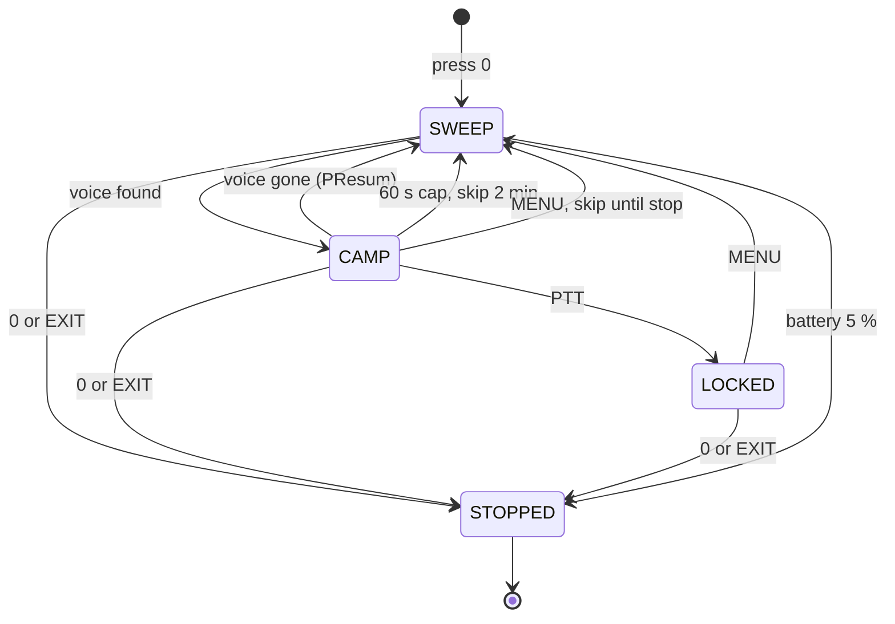

# What's New in VUURWERK v1.5.1

- **PATROL is new.** The VOX voice hunt now runs hands-free: set a range,
  press 0, and the radio walks it, stops on voices and moves on by itself.
- **The biggest fix pass VUURWERK has had.** The headline fixes are on the
  transmit side: leaving the spectrum with PTT held, a freeze on a nearly
  flat battery, and VFO Split walking your own VFO can no longer put you on
  the air where you did not mean to be.
- **Flash it the usual way.** See [FLASHING.md](FLASHING.md). Your channels
  and settings survive the upgrade.

If you are coming from v1.5.0 or any v1.3.x build, this page is your tour.
The full list is in [CHANGELOG.md](CHANGELOG.md).

## 1 PATROL

Open the spectrum (F+5, with F being the # key), press STAR (the * key)
until the corner says `VOX`, and you have the hand-held voice hunt. PATROL
is that hunt with the radio holding the keys for you.

| In VOX mode | Does |
|---|---|
| 2 | Range start = left edge of the window on screen; toast `SET LO` |
| 8 | Range stop = right edge of the window on screen; toast `SET HI` |
| 0 | Start PATROL; the corner label changes from `VOX` to `PTRL` |

| While PATROL runs | Does |
|---|---|
| 0 | Stop PATROL and go back to the hand-held hunt |
| MENU | Skip the frequency it is camped on until PATROL stops |
| PTT | Lock the voice it is camped on (`LOCKED`) |
| EXIT | Stop PATROL and leave the spectrum |

Every other key is inert while PATROL runs. If the screen has gone dark, the
first press of any key only wakes the backlight.

### Setting the range

1. **Press 4 and 1 or 7** to choose the bin count and the scan step. Use
   your channel spacing, or a step that divides it.
2. **Press EXIT**, tune the VFO to one of your channels, and reopen the
   spectrum with F+5 so the window sits on your channels.
3. **Move the window with UP, DOWN, SIDE1 or SIDE2** until its left edge is
   where the range should begin.
4. **Press 2.** The toast says `SET LO`.
5. **Move the window to where the range should end and press 8.** The toast
   says `SET HI`. The step and modulation are saved with the range.

Press 0 and PATROL walks the range one window at a time, lap after lap. Each
press of 2 or 8 replaces only its own edge. If only one edge is set, or the
stop is not above the start, PATROL sweeps the window on screen instead. The
range survives power cycles and Reset.

This diagram shows what PATROL does from the moment you press 0.



PATROL stops only on signals that score as voice. A keyed carrier with
quiet audio can still hold a camp for a while once listening has started,
because a quiet carrier sounds like a pause in speech; that is what the 60 s
cap and the MENU skip are for. Nothing holds it forever on its own: after 60 s on one frequency it moves on
and skips that frequency for 2 minutes of sweeping. A PTT lock is never
capped. At 5 % battery or less PATROL stops and the spectrum closes so the
`LOW BATTERY` warning can show. The backlight times out during PATROL as set
in BackLt; any key restarts it, and the light comes back on when you stop.

| Menu > SCAN | Values | What it changes |
|---|---|---|
| PSens | LOW / NORM / HIGH | LOW wants a cleaner voice; HIGH stops on weaker signals |
| PSpeed | SLOW / NORM | SLOW settles longer on each bin for a steadier read |
| PDwell | SHORT / NORM / LONG | Guaranteed listen after a hit: 0.5 / 1 / 2 s |
| PResum | SHORT / NORM / LONG | Moves on about 0.3 / 0.6 / 1.2 s after the voice ends |

All four carry the hint `PATROL ONLY` and leave the hand-held hunt alone.
With all four on NORM, PATROL behaves exactly like the hunt. The full
walkthrough is in [USER_MANUAL.md](USER_MANUAL.md#8-patrol).

## 2 Fixes you will notice

| If you saw this | Now |
|---|---|
| Radio transmitted when you left the spectrum with PTT squeezed | It waits; release PTT and press again |
| Radio froze on a nearly flat battery, sometimes with the carrier up | Fixed |
| Deaf after a 1750 Hz tap or a TX timeout | Receiver comes back |
| Split stepped your own VFO through the channels | Split hops only while VFO A is selected |
| Deaf or silent monitor after the spectrum | Audio, monitor and squelch always return |
| Menu tone scan wiped your offset and tone | The VFO is put back when the scan ends |
| STE did nothing on CTCSS channels | Tail mute works on CTCSS and DCS |
| TX timer and RX line stood still | The main screen repaints twice a second |
| Opening a blank memory slot changed settings | Viewing a blank slot is safe |
| Locked keypad, side key still opened the spectrum | Refused, with the unlock prompt |

### On the air

- Leaving the spectrum with PTT held no longer transmits, whether you
  pressed EXIT or PATROL's low-battery stop ended the session.
- On a nearly flat battery the radio could freeze; fixed.
- A crash can no longer hold the transmitter on; the radio restarts instead.
- Pressing PTT with a key still held (UP, DOWN or a held digit) transmits
  on the frequency, power and reverse shown on the screen, and letting go
  mid-over keeps the carrier up. A busy channel still refuses TX.
- Holding EXIT while transmitting no longer drops the carrier.
- A TX timeout landing just after you unkeyed no longer replays the roger
  beep and tail, and a very short PTT blip no longer leaves the transmitter
  half-armed while receiving.
- AM and USB keep their own mic level for the whole over.
- A channel saved with a corrupt power setting transmits on LOW.

### Spectrum and VOX

- After leaving the spectrum, monitor comes back if it was on, a station
  that is talking is heard at once, the green light goes out when nothing is
  there, and the status bar is redrawn.
- A long press that opens the spectrum does nothing inside it, and a held
  EXIT acts once.
- `LOCKED` shows the moment you press PTT; UP or DOWN clears it; no stale
  banner returns at the next session.
- Small steps (under 2.5 kHz) open centred on your VFO frequency.
- The corner label reads `PTRL  FM` cleanly, at every frequency.
- PEAK dots sit on top of their bars; key 6 changes the listen bandwidth at
  once; AM and USB survive the found-voice chord; the chord respects Beep
  OFF; the flashlight auto-off keeps counting inside the spectrum.

### Tone scans

- MENU into RxCTCS or RxDCS, then STAR, no longer clears your offset, TX
  tone and power; the VFO is put back the moment the scan ends.
- A found tone lands on the right item (RxCTCS or RxDCS) and beeps.
- The menu does not time out while its scan runs; in plain CROSS BAND the
  scan is refused with a double beep.
- F+STAR shows the frequency you are on and says `NO SIGNAL` when there was
  nothing to scan.

### Main screen, keys and menus

- The RX line reads like `RX S4 -105dBm Q2`, so weak readings fit.
- Scan+Watch shows `S+W` in the status bar; an empty-list MR scan keeps its
  `EMPTY LIST` toast.
- The screen updates before the key click; refused F shortcuts double-beep
  (`FREQ ONLY`, `NO CHANNELS`, `NO BAND`); a STAR tap no longer swallows the
  next key; F+4 keeps unsaved memory edits.
- About closes when a signal arrives, so a call is never missed.
- Four DTMF items that did nothing are hidden. PTT ID stays, and D ST's hint
  reads `1750/APOLLO SIDETONE`.
- BatCal refuses typed digits (use UP and DOWN); PTT works on the category
  screen; long menu hints are no longer clipped.

### Dual watch, VFO Split and receive gain

- Disarming Split mid-hop puts the receiver back on VFO A.
- Split alerts once each time a channel goes from quiet to busy, for every
  busy channel.
- Split no longer undoes F+9 or other tuning on VFO A, stands aside for
  scans and monitor, and VFO B is heard correctly on every band.
- Dual watch listens at the right gain right after a flip, and moving from
  FM to AM or USB restores the stock gain.

### Battery, flashlight, boot and CHIRP

- A transmit sag no longer starts the low-battery shutdown.
- Flashlight blink, SOS and auto-off keep working on a low battery.
- The `BK4819 FAULT` banner stays on screen with the backlight on while the
  fault persists, and shows even with POnMsg set to NONE.
- CHIRP: a corrupted upload packet is rejected safely.
- The TX timer no longer shows garbage with TxTOut at 15 min, the radio no
  longer drops into power save the instant you leave the spectrum, and the
  PATROL settings are live from power-on.

## 3 F+9 calling-frequency jump

F+9 now behaves like keying the calling frequency in: offset direction off,
CTCSS and DCS off, reverse off, scrambler off, modulation and step set for the
band, and the result is saved. The toast says `CALL FREQ`.

| Where you are | F+9 goes to |
|---|---|
| 144.000 to 144.300 (2 m SSB) | 144.200 USB |
| 144 to 148 (2 m FM) | 146.520 FM |
| 432.000 to 433.000 (70 cm SSB) | 432.100 USB |
| 420 to 450 (70 cm FM) | 446.000 FM |
| 151 to 154 (MURS) | 151.940 FM |
| 462 to 467 (FRS/GMRS) | 462.5625 FM |
| 26.9 to 27.41 (CB, channel 40 included) | 27.185 FM |
| 156 to 162 (marine) | 156.800 FM |
| 118 to 136 (air) | 121.500 AM |

Outside those bands you get `NO BAND`; on a memory channel `FREQ ONLY`, and
nothing is touched. The jump is one way: the second press that used to take
you back is gone, so key your old frequency in to return. Holding a digit on
the main screen is the same as F and that digit, so a held 9 jumps too.

## 4 A new look and what was retired

- The frequency reads `146.52000` in the standard font (it used to read
  `146.520.00` in big digits).
- The compander glyph sits at the right of the second row, on memory
  channels too.
- The main screen repaints twice a second while transmitting, receiving or
  monitoring, so toasts clear after about a second.
- Menu hints are shorter and stay on the items whose names are cryptic.
- The gain editor under the STILL meter is gone; MENU does nothing there.
- F+9 no longer undoes itself on a second press.
- The class letter left the RX line.

## 5 Carried over from v1.5.0

These arrived in v1.5.0 and earlier and are repeated here for anyone coming
from v1.3.x.

### VOX Voice Lock

Press F+5, then STAR until the corner says `VOX`. Only bins that sound like
voice draw bars; carriers and birdies stay flat on the floor.

```
+----------------------------+
| -130/-50            [BATT#]|
| 64x  146.52000     VOX  FM |
| 25.00k                 25k |
|    .          .        #   |
|    #          =        #   |
|  _.#_______.__=________#__ |
| |..|....|....|....|..^.|.| |
|145.76000 >800.00k 147.36000|
+----------------------------+
```

| Row | What it shows |
|---|---|
| Status bar | Scale floor and ceiling in dBm, battery icon |
| Row 0 | Bin count, peak frequency, mode label, modulation |
| Row 1 | Scan step, listen bandwidth |
| Rows 2 to 4 | Voice bins as bars (`#` strong, `=` probable) with a dot on top; everything else a baseline dot |
| Row 5 | Tick rail with `^` under the peak |
| Row 6 | Window start, navigation step (`>` stands for the arrow glyph), window end |

| Key | Does |
|---|---|
| UP / DOWN | Seek the next voice above or below; with none that way, move the window |
| SIDE1 / SIDE2 | Move the window without seeking |
| PTT | Lock the voice you are hearing; `LOCKED` shows on rows 2 to 3 |
| MENU | Blacklist the current peak and sweep again |
| EXIT | Leave; a locked frequency follows you out |

PTT only locks while the spectrum is listening to a voice; with nothing heard
it does nothing. A lock holds through any pause, with the squelch open, so
you hear both sides. Press EXIT while locked, in frequency mode and on the
same band, and the locked frequency and modulation become your VFO. Your
VFO's offset and tones stay; if `+`, `-`, `CT` or `DCS` show after a simplex
find, press F+EXIT before you answer. A memory channel is never changed. See
[USER_MANUAL.md](USER_MANUAL.md#vox-mode).

### F+EXIT

One gesture clears a polluted VFO. On a memory channel you get `FREQ ONLY`
and nothing changes.

| Before F+EXIT | After F+EXIT |
|---|---|
| RX or TX CTCSS/DCS set | Tones off |
| Repeater offset and direction | TX = RX, direction off |
| Reverse on | Reverse off |
| Scrambler on | Scrambler off |
| AM or USB | FM |
| Toast | `SIMPLEX` |

### Leaving the spectrum

EXIT lands you on the VFO you entered from, tuned to your displayed
frequency with audio alive, lock or no lock, dual watch or not.


### Spectrum modes

STAR cycles three modes; the current one is in the top-right corner, with
`PTRL` replacing `VOX` while PATROL runs.

| Mode | What the bars show | When to use |
|---|---|---|
| NORM | Live signal strength | What is on the air right now |
| PEAK | Live bars plus peak-hold dots | Catching brief transmissions |
| VOX | Voice bins only | Looking for conversations, not carriers |

### Also since v1.3.3

- Scanning quiet bands runs 2 to 3 times faster; tone-coded channels get
  the dwell the decoder needs.
- Dual watch and VFO Split pause while you hold a key.
- The middle and upper Mic steps drive about 2 dB harder.
- A bug that could silently change saved settings was fixed.
- Tail mute works on DCS channels.

## Cheat sheet delta

Each row applies to the named context only.

| Context | Gesture | Before | Now |
|---|---|---|---|
| Main screen | F+9 | Jump, second press returned | Clean simplex jump, saved; `FREQ ONLY` on a channel |
| Main screen | F+EXIT | Nothing | Reset the VFO to simplex (`SIMPLEX`) |
| Main screen, keypad locked | Side key or M Long = SPECTRUM | Opened the spectrum | Refused (double beep, unlock prompt) |
| Spectrum | STAR | NORM / PEAK / MTI / VOX | NORM / PEAK / VOX |
| Spectrum | EXIT held | Could quit the spectrum | Acts once |
| Spectrum, STILL view | MENU | Opened the gain editor | Nothing |
| Spectrum, VOX mode only | UP / DOWN | Wrap-around hop | Directional seek, then window move |
| Spectrum, VOX mode only | PTT | Opened the STILL view | Lock the voice (`LOCKED`) |
| Spectrum, VOX mode only | EXIT while locked | Frequency lost | Frequency and modulation carry to your VFO |
| Spectrum, VOX mode only | 0 | Cycle modulation | Start or stop PATROL |
| Spectrum, VOX mode only | 2 / 8 | Navigation step size | Set PATROL range start / stop |
| PATROL camped | MENU | (new) | Skip that frequency until PATROL stops |

Everything else is where you left it.

73 de KC3TFZ
