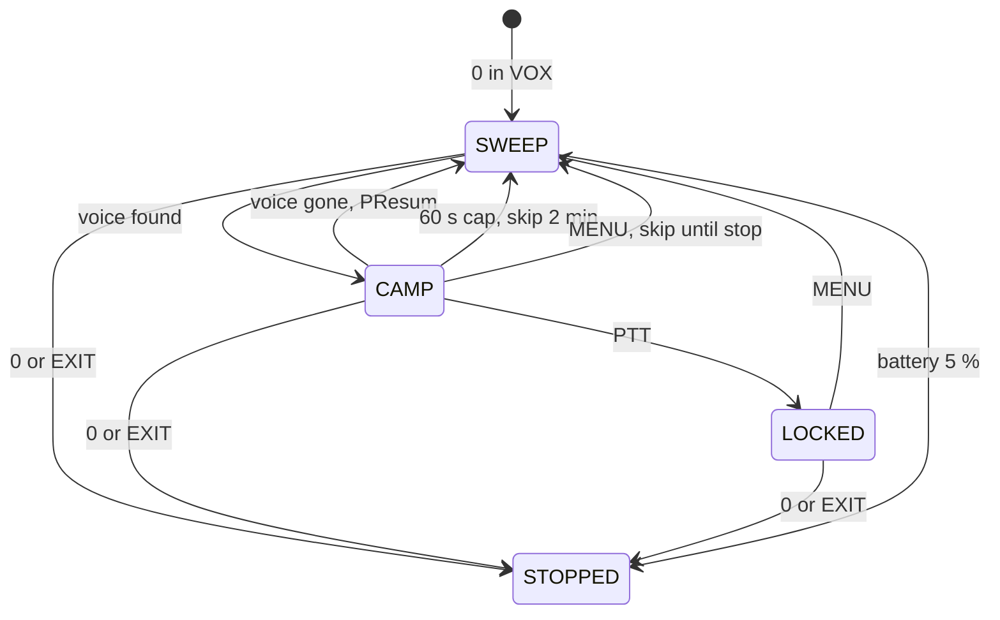

# What VUURWERK Does

VUURWERK is custom firmware for the Quansheng UV-K5. It keeps everything the
stock radio does and adds a layer of features on top. This page explains each
one as you meet it on the radio in v1.5.1: what it is for, how you use it and
what you see. For the button-by-button detail see
[USER_MANUAL.md](USER_MANUAL.md); for what changed between versions see
[WHATS_NEW.md](WHATS_NEW.md) and [CHANGELOG.md](CHANGELOG.md).

## Contents

| Group | Features |
|---|---|
| [Transmit](#transmit) | 1 Soft key-up, 2 Tone lead-in, 3 TX compressor, 4 Live battery in TX, 5 Sag toast, 6 Quiet backlight |
| [Receive](#receive) | 7 Adaptive receiver gain, 8 True S-meter, 9 AM guard, 10 Signal quality |
| [Squelch](#squelch) | 11 Smart squelch, 12 Squelch tail elimination |
| [Scanning and Watch](#scanning-and-watch) | 13 Adaptive scan, 14 Scan rate, 15 Dual watch, 16 Scan+Watch, 17 VFO Split, 18 Tone scan |
| [Spectrum and VOX](#spectrum-and-vox) | 19 Spectrum analyzer, 20 PEAK, 21 VOX voice-seeking, 22 Lock and carry-over, 23 STILL view |
| [PATROL](#patrol) | 24 PATROL |
| [Interface](#interface) | 25 Categorised menu, 26 F shortcuts, 27 Side-key toasts, 28 Context line, 29 Bandscope, 30 F+EXIT, 31 F+9, 32 About screen |
| [Safety and Care](#safety-and-care) | 33 Flashlight auto-off, 34 Crash restart, 35 Boot check, 36 Backlight fade and hold |

Key names: STAR is the * key and F is the # key. "F+6" means press F, let
go, then press 6.

## Transmit

### 1. Soft key-up
**Your key-up is click-free.** The power ramps up smoothly when you press PTT
instead of slamming on, so the station on the other end hears your first
word and not a pop. Nothing to set; FM only.

### 2. Tone lead-in
**The repeater hears your tone before it hears you.** On a channel with a TX
CTCSS or DCS tone, the microphone stays muted for a moment after PTT so the
repeater can decode the tone and open. Your first syllable is no longer
clipped. Nothing to set; FM only, and only when a TX tone is set.

### 3. TX compressor
**You sound even and punchy.** Speak softly and the radio lifts you; shout
and it holds you back. It catches a sudden loud word at once and eases back
smoothly, so your audio sounds like a commercial two-way radio. Nothing to
set; FM only. The About screen lists it as `TX Compressor`.

### 4. Live battery in TX
**The battery icon keeps moving while you transmit.** The stock radio freezes
the icon the moment you press PTT. VUURWERK updates the icon and the voltage
every half second during the over, so you watch the sag as it happens.

### 5. Sag toast
**A tired pack tells you.** After an over, if the voltage dropped by 0.20 V or
more under load, a toast such as `SAG 0.25V` shows for about a second. The
About screen keeps the last measurement as `TX sag 250mV`. A healthy pack
sags little; a worn one sags a lot.

### 6. Quiet backlight
**No whine in your transmitted audio.** The backlight dimmer runs well above
the audio band, so a dimmed screen no longer puts a hum into your TX audio.
Technique credited to kamilsss655. Nothing to set.

## Receive

### 7. Adaptive receiver gain
**Strong signals stay clean, weak ones stay audible.** The receiver adapts its
gain to the signal in front of it: fast when a strong station appears, so it
does not overload, and gently as it fades, so the audio does not pump. Dual
watch, USB and VFO Split do not upset it. Nothing to set; FM only.

### 8. True S-meter
**The S-meter always shows real signal strength**, whatever the receiver gain
is doing. The centre line reads it as a bar, the bottom line as
`RX S7 -83dBm Q3`, and both agree.

```
+----------------------------+
|RX                  [BATT#] |
|  146.52000              F2 |
|                            |
|       H                    |
| -83 S7     [#######....]   |
|  446.00000                 |
|                            |
| RX S7 -83dBm Q3            |
+----------------------------+
```

| Row | What is there |
|---|---|
| status bar | RX icon left, Q bars, battery right |
| row 0 | VFO A frequency, band label F2 |
| row 3 | strength and S-level, then the bar |
| row 6 | the RX line: S-level, dBm, quality |

### 9. AM guard
**Airband stays undistorted.** Strong AM signals no longer saturate the
receiver. Inherited from the OneOfEleven project; Menu > RECEIVE > AM Fix
turns it ON or OFF.

### 10. Signal quality
**Q3 is solid, Q0 is flutter.** While you receive, the radio watches how
steady the signal is and rates it Q0 to Q3 on the RX line and as bars in the
status bar. A nearby station reads Q3; one bouncing off buildings or fading
reads lower. A quick read on propagation without test gear.

## Squelch

### 11. Smart squelch
**Fewer false opens, and real voices get through.** The radio learns the idle
noise floor on your frequency and weighs strength, audio cleanliness and
interference together to decide whether it is hearing a voice. A likely
voice opens the squelch a little earlier; noise is held back. Menu > RECEIVE
> Sql still sets the level you want; the smart part works underneath it.

### 12. Squelch tail elimination
**No "kssshh" when the other station unkeys.** On a CTCSS or DCS channel the
audio is muted the instant the tone disappears, before the noise burst
reaches the speaker. DCS channels get a slightly longer window. It works with
any make of repeater. Menu > TONE > STE turns it ON or OFF; RP STE sets an
extra delay for repeaters that need one.

## Scanning and Watch

### 13. Adaptive scan
**Empty channels skip almost instantly.** The scanner only lingers where there
is energy, so a quiet band scans two to three times faster, and any channel
with a signal gets the same full check as before. Channels with a tone get
time for the decoder to confirm. Nothing to set.

### 14. Scan rate
**The bottom line shows the live scan speed** as `SCANNING 12c/s` (channels
per second). If it slows down, you see why at a glance.

### 15. Dual watch
**Both VFOs are watched without missing a call.** Set Menu > RECEIVE > RxMode
to DUAL RX RESPOND, CROSS BAND or MAIN TX DUAL RX. Dual watch alternates
quickly between the VFOs, gives the busier one shorter looks and the quieter
one longer ones, and pauses while you hold a key so manual tuning is never
interrupted.

### 16. Scan+Watch
**Scan one VFO, keep an ear on the other.** Menu > SCAN > ScnWch set to SCAN
A WATCH B or SCAN B WATCH A. While the scan runs it checks the watch VFO
every few steps; when it hears something it listens there while the
signal lasts, holds for 2 seconds after it drops, then resumes the scan.
The status bar shows `S+W`. MONITOR counts as a signal, so the hold never
ends under you.

### 17. VFO Split
**VFO B walks your channels while you listen on A.** Menu > SCAN > ScnWch
set to SPLIT. VFO Split checks VFO B about three times a second without
interrupting VFO A, and when a channel goes from quiet to active it shows
`ACT 146.52000` with a beep, once per burst of activity. The status bar shows
`SP`. It stands aside during scans, while you transmit, with MONITOR on, and
whenever VFO B is the active VFO. An unsaved change on A (an F+9 jump, for
example) survives the hops.

### 18. Tone scan
**Find the repeater's tone in seconds.** On the main screen press F+STAR
while the station is transmitting. The scanner screen shows the frequency,
`CTC:******` while it searches, then the tone and `SCAN CMP.` with a beep.
`NO SIGNAL` means there was no carrier to read; `SCAN FAIL.` with a double
beep means nothing was found in 30 seconds and your VFO is left exactly as it
was. MENU saves the tone (MENU again at `SAVE?`; on a memory channel you
first pick the channel number, then MENU again); EXIT discards it. The
status bar shows `Cs` while it runs. FM only: in AM or USB the toast says
`FM ONLY`. You can also scan from Menu > TONE > RxCTCS or RxDCS with STAR.

## Spectrum and VOX

### 19. Spectrum analyzer
**See the band.** Press F+5 (or a side key set to SPECTRUM). The sweep opens
centred on your frequency, 64 steps of 25 kHz wide, in your VFO's modulation.
STAR cycles the display mode NORM, PEAK, VOX, with the name shown briefly.

```
+----------------------------+
|-130/-50            [BATT#] |
|64x  146.52000     NORM  FM |
|25.00k         #        25k |
|     #    #    #   #        |
|  #  #   ##  # #  ##  #     |
| ##_##__###_####_###_##_#_  |
||..|....|....|....|..^.|..| |
|145.76000 >80.00k  148.96000|
+----------------------------+
```

| Row | What is there |
|---|---|
| status bar | scale floor and ceiling in dBm, battery |
| row 0 | step count, peak frequency, mode label, modulation |
| row 1 | scan step on the left, listen bandwidth on the right |
| rows 0-4 | the bars; a dotted line marks the trigger level |
| row 5 | tick rail, with the arrow under the peak |
| row 6 | span start, navigation step (the `>` stands for the arrow glyph), span end |

| Key | NORM / PEAK | VOX | PATROL running |
|---|---|---|---|
| UP / DOWN | move the span | seek the next voice up / down, else move the span | ignored |
| SIDE1 / SIDE2 | move the span | move the span | ignored |
| 1 / 7 | scan step up / down | same | ignored |
| 2 / 8 | navigation step bigger / smaller | `SET LO` / `SET HI` range edges | ignored |
| 3 / 9 | scale ceiling up / down | same | ignored |
| 4 | bins 64, 128, 16, 32 | same | ignored |
| 5 | type a frequency | same | ignored |
| 6 | listen bandwidth 25k, 12.5k, 6.25k | same | ignored |
| 0 | modulation FM, AM, USB | start / stop PATROL | stop PATROL |
| STAR | next mode | same | ignored |
| F | lower the trigger line | same | ignored |
| MENU | blacklist the peak | same | skip the camped frequency |
| PTT | STILL view on the peak | lock the voice (`LOCKED`) | lock |
| EXIT | leave | leave | stop PATROL and leave |

When the strongest bin rises above the trigger line the radio tunes there
and opens the audio, and goes back to sweeping once it drops. EXIT always
puts you back on your own VFO, hearing normally, with monitor restored if it
was on; a PTT still held as you leave is ignored.

### 20. PEAK
**Catch the brief ones.** PEAK draws the NORM bars plus a dot per bin at the
strongest level seen, slowly sinking, so a transmission that lasted one sweep
still leaves its mark.

### 21. VOX voice-seeking
**Bars only where people are talking.** In VOX the radio scores every bin for
voice. A half-height bar means probable voice, a full bar strong voice, and a
dot on the baseline means nothing worth stopping for; a dot on the very top
row marks every bin the seek will stop on. Carriers and birdies stay flat.

```
+----------------------------+
|-130/-50            [BATT#] |
|64x  146.55000     VOX   FM |
|25.00k   .      .       25k |
|         #      #           |
|      .  #      #  .        |
| .....=..#......#..=......  |
||..|....|....|....|..^.|..| |
|145.76000 >80.00k  148.96000|
+----------------------------+
```

UP seeks the next voice bin above the cursor, DOWN the next below; a found
voice plays a rising two-tone chord. With no voice that way, the span moves
instead. On its own, the sweep listens to the strongest voice bin above the
trigger, holds about a second, rides through speech gaps and lets go about
0.6 s after the voice ends. The modulation you set with 0 applies to the
sweep and to what you hear.

### 22. Lock and carry-over
**Pin a conversation, then take it home.** While you are listening in VOX,
press PTT: `LOCKED` shows and the radio stays on that frequency with the
squelch open, through any pause. UP, DOWN, STAR or MENU release it. Press
EXIT while locked and, if your VFO is in frequency mode with reverse off and
the frequency is inside the VFO's band, the locked frequency and modulation
are written into your VFO and saved. A memory channel is never written.

> **Keep bins on your channels.** The carry-over lands on the sweep bin,
> rounded to your VFO step. Open the spectrum from a VFO sitting on one of
> your channels and set the scan step (1/7) to your channel spacing, and the
> carry is exact. The VFO keeps its own offset and tones: if `+`, `-`, `CT`
> or `DCS` show after a simplex find, press F+EXIT before you answer.

### 23. STILL view
**Park on one frequency with a meter.** In NORM or PEAK press PTT and the
radio parks on the peak and shows a meter.

```
+----------------------------+
|                            |
|  146.52000              FM |
|                        25k |
| [#######...|......]        |
| S: 7   -83 dBm             |
|                            |
|                            |
|                            |
+----------------------------+
```

UP and DOWN tune in fine steps, STAR and F raise and lower the trigger
marker, 5 types a frequency, 0 changes modulation, 6 the bandwidth, SIDE1
toggles monitor, SIDE2 the backlight. EXIT returns to the sweep.

## PATROL

### 24. PATROL
**The voice hunt runs on its own.** PATROL takes the VOX hunt and walks a
range you choose, window by window, lap after lap, stopping to listen
whenever it hears a voice and moving on when the voice stops. You set it
once and let the radio do the listening. The full guide with pictures is in
[README.md](README.md#patrol-hunt-while-you-do-something-else) and the
reference in [USER_MANUAL.md](USER_MANUAL.md#8-patrol).

#### Set the range

1. **Open the spectrum** (F+5) and press STAR until the label reads `VOX`.
2. **Move the span** (UP, DOWN, SIDE1, SIDE2) until its left edge is the
   start of your range, then **press 2.** The toast says `SET LO`.
3. **Move the span** until its right edge is the end of your range, then
   **press 8.** The toast says `SET HI`.

Each press replaces only its own edge and saves the scan step and modulation
in force with the range. The range survives power cycles and Reset. With no
valid range (stop not above start, or only one edge set) PATROL walks the
span on screen.

#### Start and stop

Press **0** in VOX. The corner label changes from `VOX` to `PTRL`. Press 0
again, or EXIT, to stop; stopping lights the backlight and leaves whatever
you were hearing playing.

```
+----------------------------+
|-130/-50            [BATT#] |
|64x  146.55000     PTRL  FM |
|25.00k          .       25k |
|                #           |
|                #           |
| ...............#.........  |
||..|....|....|....|..^.|..| |
|145.76000 >80.00k  148.96000|
+----------------------------+
```

#### While it runs

| Key | Does |
|---|---|
| 0 | stop PATROL (the lock or camp stays) |
| MENU | while camped: skip this frequency until PATROL stops |
| PTT | lock on the voice you are hearing, `LOCKED`; never capped |
| EXIT | stop PATROL and leave, carrying a lock to your VFO |
| any other key | ignored; on a dark screen the first key only wakes the backlight |

A camp (PATROL stopping on a voice by itself) is cut off after 60 seconds
and that frequency is skipped for about 2 minutes of sweeping, so one busy
repeater cannot hold the hunt. A PTT lock is your decision and is never cut
off; release it with MENU (skip and move on), 0 (stop PATROL) or EXIT.

This is the cycle PATROL runs.



#### Settings

All four live in Menu > SCAN, show the hint `PATROL ONLY`, and change
nothing outside PATROL. NORM is the default for each.

| Item | Values | What it changes |
|---|---|---|
| PSens | LOW, NORM, HIGH | LOW wants a cleaner voice before stopping; HIGH stops on weaker signals |
| PSpeed | SLOW, NORM | SLOW sweeps a little slower for a steadier read |
| PDwell | SHORT, NORM, LONG | guaranteed listen after a hit: 0.5 s, 1 s, 2 s |
| PResum | SHORT, NORM, LONG | how long after the voice ends it moves on: about 0.3 s, 0.6 s, 1.2 s |

#### What it stops on

PATROL stops on voice, and also on idle repeater carriers, birdies and
in-band data tones, because a clean quiet signal looks like a pause in
speech. MENU and the 60 s cap keep it moving past the false ones.

#### Battery and backlight

The backlight follows Menu > CONFIG > BackLt while PATROL runs, so the screen
can go dark; the first key only wakes it. At 5 % battery or less PATROL stops,
the spectrum closes and the main screen shows `LOW BATTERY`. PATROL will not
run the pack flat, but the radio stays on: switch it off or charge it if it
may be left longer.

## Interface

### 25. Categorised menu
**Find a setting in seconds.** MENU opens a picker with six categories, and
the number keys jump straight in.

```
+----------------------------+
|                    [BATT#] |
| 1 RECEIVE                  |
|>2 TONE<                    |
| 3 TX                       |
| 4 SCAN                     |
| 5 CHANNEL                  |
| 6 CONFIG                   |
|                            |
+----------------------------+
```

The cursor row is shown inverted. A seventh category, UNLOCK, appears only
when the radio is powered on with PTT and SIDE1 held. Inside a category,
items with cryptic names show a plain hint on the bottom line, such as
`DUAL WATCH/XBAND` under RxMode. The picker remembers where you were.

### 26. F shortcuts
**One gesture for the things you change most.** Press F, then a digit, and a
toast confirms it for about a second. Holding a digit on the main screen does
the same without F.

| Keys | What it does | Toast |
|---|---|---|
| F+0 | modulation FM, AM, USB | `MOD: FM` `MOD: AM` `MOD: USB` |
| F+1 | next band | `BAND` (`FREQ ONLY` in memory mode) |
| F+2 | switch VFO | `VFO: A` `VFO: B` |
| F+3 | frequency or memory mode | `VFO MODE` `MR MODE` (`NO CHANNELS`) |
| F+4 | squelch level | `SQL: 0` to `SQL: 9` |
| F+5 | spectrum analyzer | none |
| F+6 | TX power | `PWR: LOW` `PWR: MID` `PWR: HIGH` |
| F+7 | bandscope | `SCOPE ON` `SCOPE OFF` |
| F+8 | reverse | `REVERSE` `NORMAL` |
| F+9 | calling frequency | `CALL FREQ` (`FREQ ONLY`, `NO BAND`) |
| F+STAR | tone scan | `FM ONLY` in AM or USB |
| F+EXIT | reset to simplex | `SIMPLEX` (`FREQ ONLY`) |

A refused shortcut gives a double beep with its toast. Hold F to lock the
keypad: `LOCKED` and `UNLOCKED`.

### 27. Side-key toasts
**The side keys answer too.** Whatever SIDE1, SIDE2 or a long MENU press is
bound to (Menu > CONFIG > F1Shrt, F1Long, F2Shrt, F2Long, M Long), the radio
confirms it the same way: `MON ON` and `MON OFF`, `SCAN ON` and `SCAN OFF`,
`PWR: HIGH`, `VFO: B`, `MR MODE`, `MOD: AM`, `LOCKED`. Choices: NONE, FLASH
LIGHT, POWER, MONITOR, SCAN, LOCK KEYPAD, SWITCH VFO, VFO/MR, SWITCH DEMODUL,
SPECTRUM.

### 28. Context line
**The bottom line always says what matters now.**

| State | Line |
|---|---|
| idle | `12.5kHz W FM` (step, wide or narrow, modulation) |
| receiving | `RX S7 -83dBm Q3` |
| transmitting | `TX 0:07 PWR:H` (elapsed time, power) |
| scanning | `SCANNING 12c/s` |

The screen repaints every half second while you transmit or receive, so the
timer, the RX line and toasts stay live.

### 29. Bandscope
**A heartbeat for your frequency.** F+7 puts a scrolling strip of signal
strength on the centre line, with peak dots that fade and a dotted line at
the noise floor. `SCOPE ON` and `SCOPE OFF` confirm it.

### 30. F+EXIT
**The rescue key.** One gesture returns the VFO to clean simplex: offset off,
RX and TX tones off, scrambler off, reverse off, FM, saved. Toast `SIMPLEX`.
It cures the "green light but silent" VFO where a leftover RX tone holds the
audio shut. Frequency mode only: on a memory channel it says `FREQ ONLY`.

### 31. F+9
**Straight to the calling frequency.** F+9 jumps to the band's calling
frequency, simplex, no tones, in that band's modulation and step, and saves:
146.520 FM on 2 m, 446.000 FM on 70 cm, 144.200 and 432.100 USB, 121.500 AM
on airband, 156.800 FM marine, 27.185 FM on CB, 462.5625 FM and 151.940 FM
on the licence-free bands. Toast `CALL FREQ`; `NO BAND` where the band has no
entry; `FREQ ONLY` in memory mode. Key your old frequency in to go back.

### 32. About screen
**What is on the radio, and how your pack is doing.** Menu > CONFIG > About,
then MENU.

```
+----------------------------+
|                    [BATT#] |
| VUURWERK v1.5.1            |
|   Precision RF             |
| Adaptive Squelch           |
| Signal Quality             |
| Spectrum+                  |
| TX Compressor              |
| TX sag 250mV               |
+----------------------------+
```

It closes on EXIT or MENU, when a signal arrives, or after about 10 seconds.

## Safety and Care

### 33. Flashlight auto-off
**A forgotten flashlight no longer drains the pack.** The LED switches off
after 30 minutes, or 10 minutes when the battery shows two bars or fewer.
SOS mode is exempt because it is emergency signalling. Tap the flashlight
key to extend the session. It keeps counting inside the spectrum and PATROL.

### 34. Crash restart
**A crash can never hold the transmitter on.** If the processor ever faults,
the radio restarts itself and comes back receiving on your VFO instead of
freezing with the carrier up.

### 35. Boot check
**The radio checks itself at power-on.** If the transceiver does not answer
or the battery calibration is missing, a `BK4819` / `FAULT` / `RX/TX
disabled` or `EEPROM` / `FAULT` / `calib lost` banner replaces the boot
screen, even with POnMsg set to NONE. [FLASHING.md](FLASHING.md) shows both
banners and what to do.

### 36. Backlight fade and hold
**The screen fades out instead of cutting to black**, over about 2 seconds,
and with Menu > CONFIG > BltTRX set to TX, RX or TX/RX it stays lit for the
whole over or reception rather than timing out mid-call.

Nothing stock is removed; VUURWERK adds to it. For the history of each
feature see [WHATS_NEW.md](WHATS_NEW.md) and [CHANGELOG.md](CHANGELOG.md);
for the people behind the parent projects see [CREDITS.md](CREDITS.md).

73 de KC3TFZ
